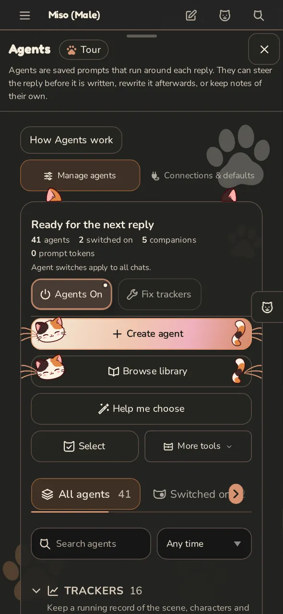

# Agents and Companions

Agents do recurring jobs around a reply: add instructions, rewrite prose or keep a tracker. A **Companion** writes a separate note without replacing the character's reply.

=== "Computer"

    <figure class="screenshot" markdown>
    
    <figcaption>Start with one helper and check its Quick settings.</figcaption>
    </figure>

=== "Phone"

    <figure class="screenshot screenshot--phone" markdown>
    
    <figcaption>Browse library adds helpers. Help me choose recommends some for your chat.</figcaption>
    </figure>

!!! info "New in the 1.5.6 candidate"
    **Clothing Tracker**, **Skip user messages**, the **On Companions** picker for selected Agents, **Rerun agents** on a **Reply interrupted** notice, the Companion panel's jump buttons and Memory Shard's new defaults come from the Neconyan 1.5.6 staging candidate at commit **00be4b8e**, which I reviewed on 18 November 2026. Version 1.5.6 is not published yet. The current published release is [1.5.5](https://github.com/platberlitz/Neconyan/releases/tag/v1.5.5), where these won't appear.

## Start with one helper

1. Open **Agents** and choose a helper. **Help me choose** asks a few questions and recommends some. **Browse library** has more.
2. Open **Quick settings**. Check its connection, when it runs and how much it can write. **Edit** opens every control.
3. Turn on both **Agents On/Off** and the helper's own switch.
4. Try one short turn and read the result.

**Help me choose** makes no model request and changes nothing until you approve its picks. **Undo** switches those picks off. Anything added from the library stays installed.

Use **Manage agents** to filter by type, timing or enabled state. **Connections & defaults** holds shared settings. **More actions** on a card includes Export and Delete.

The page remembers your selected view and folded categories, so reopening Agents doesn't reset the list you were using.

**Save changes** applies Quick settings. **Open full editor** saves them before opening the complete editor. When you edit several selected Agents at once, fields you don't touch stay as they were.

??? info "Updating bundled Agents"
    The version beside a saved Agent describes that copy. **Browse library** shows the available template version. **Agent updates ready → Update all** lists the outdated copies. Before replacing them, it warns about prompts you've edited. Connection overrides stay, and so do your Companion, context, enabled, pin and order choices. **Dismiss** hides the banner until a newer update. The individual **Update** buttons remain.

## Bundled reply rewriters

These arrive switched off. Each enabled rewriter can add a model request after the main reply.

| Helper | Use it for… |
| --- | --- |
| **Continuity Corrector** | Contradictions in location, clothing, injuries or possessions |
| **Proofreader** | Prose and formatting corrections |
| **Dialogue Humaniser** | More natural spoken lines |
| **Format Fixer** | Broken formatting |
| **User Agency Guard** | Actions or thoughts invented for you |
| **Knowledge Guard** | Things the character shouldn't know |
| **Character Authenticity Checker** | Out-of-character lines, while keeping earned growth |
| **Friction Keeper** | Unearned agreement |
| **Repetition Breaker** | Repeated phrasing and gestures |
| **Length Trimmer** | Replies over your target length |
| **NSFW Enhancer** | More explicit sex scenes |
| **Prompt Adherence Checker** | Rules from your enabled preset prompts, and from version 2 the instructions Agents and the Author's Note add around them |
| **Translator** | Every new reply returned in the language you name |

They change the new reply, not earlier messages or the saved card. **Recent messages to read** gives a helper earlier context. Zero shares only the reply being processed. A model can still get the edit wrong, so read it before continuing.

To let a rewriter read only the characters' replies, tick **Skip user messages in recent messages** in its editor. In **Quick settings** it's **Skip user messages**, beside **Recent messages to read**. With 10 messages, the helper then reads the last ten replies. It's off to begin with and saved for each Agent. The reply being processed, the card, persona and lore are unchanged.

Continuity Corrector starts with twelve recent messages and can use active lore, notes, trackers and prepared Mewmory facts. When Continuity Companion is also on, they share checks and completed fixes. Knowledge Guard reads saved Secrets Tracker values without rerunning it.

**Keep the original when an Agent refuses** is on to begin with, under **Connections & defaults → Context & notifications**. With it on, a helper's refusal doesn't replace your reply. If the main reply is itself a refusal, after-reply helpers are skipped.

## Translate every reply {#translator}

!!! info "New in 1.5.5"
    Translator, the **Rerun agents** button under the saved-reply warning and the version 2 templates below are new in 1.5.5. I've reviewed this guide against the published [Neconyan 1.5.5 release](https://github.com/platberlitz/Neconyan/releases/tag/v1.5.5) at commit **680a05f1** on 15 November 2026. They won't appear in 1.5.4.

**Translator** rewrites each new reply into the language you choose.

1. Switch it on in **Manage agents**.
2. Make sure **Agents On** is set.
3. Fill in **Translate into** in its **Quick settings** or the full editor.

Name the language, plus a regional variety or a level of formality if it matters, such as 'Brazilian Portuguese' or 'Casual French'. It starts as English, which also helps when a model drifts into another language halfway through a reply.

It always runs last, whatever its order number, so Proofreader, Format Fixer and the other rewriters work on the original wording first. The translation replaces the reply text, and **View agent changes** shows the original. It translates replies as they arrive, not your own messages or the earlier chat. Use **Rerun agents** on an older reply to translate that one.

Each translated reply costs a model request, and a translation can lose nuance. Check names and formatting on the first few.

## Version 2 templates {#version-2-templates}

Two bundled templates have a version 2. If you have version 1 installed, the Agents list offers the update. See 'Updating bundled Agents' above for what an update keeps.

- **Prompt Adherence Checker** also reads the active instructions that Agents and the Author's Note add before and after the main prompt, not only your enabled preset prompts. It still ignores switched-off and filtered-out prompts.
- **Memory Shard** is a library Companion that writes a compact summary once the chat reaches about 30,000 tokens, the units of text a model counts. Version 2 uses about a third fewer tokens. When [Mewmory](mewmory.md) is on, it reads Mewmory's saved story memory so the two agree.

From the 1.5.6 candidate, Memory Shard is switched on for new accounts. Older accounts switch it on in Agents. After a summary it waits until the chat has grown by about another 30,000 tokens before writing the next one, instead of running after every reply. The messages a finished summary covers are then hidden from the model. They stay readable in the chat, Mewmory still reads them, and each message's eye button shows it to the model again. Nothing is hidden when a run fails or comes back empty. In Simple Mode, **Memory** in the sidebar opens **Story so far** with the same switch and **Summarise now**.

## See Proofreader's changes

Find **Proofreader** in **Manage agents**, check its **Quick settings**, then switch it on with **Agents On**. It runs after a reply. **Apply to reply** on its card lets you try it on an existing reply first.

From the 1.5.6 candidate, an enabled Proofreader also checks the message an impersonation writes for you, including Guided Impersonate. The corrected draft goes into the message box, and nothing in the chat changes.

Open **Agent changes** on the edited message to compare the removed and added text. **Undo** restores the previous text. **Redo** reapplies the edit. I'd read the comparison before continuing the scene.

=== "Computer"

    <figure class="screenshot" markdown>
    
    <figcaption>The change history keeps the original beside the edit.</figcaption>
    </figure>

=== "Phone"

    <figure class="screenshot screenshot--phone" markdown>
    
    <figcaption>Check the edit and undo it from the same window.</figcaption>
    </figure>

This example is staged. It sends a fixed sample response through the real Agent workflow, including working Undo and Redo. In normal use your connected model writes the edit, and each pass can cost another request. The example removes repeated descriptions and shortens a gesture without changing what happens in the scene.

## Short notes before a reply

These also arrive switched off. Each makes a request before the main reply and adds a short instruction note.

| Helper | Its job |
| --- | --- |
| **Intent Reader** | Identify what your message asks for |
| **Continuity Pins** | Keep up to three immediate facts straight |
| **Repeat Spotter** | Flag phrases and beats to avoid |
| **Beat Planner** | Plan the next story beat |
| **Pace Setter** | Suggest length and where to stop |

Start with one. Several helpers doing the same job can add cost without improving the result. Deleted bundled helpers can be restored from **Browse library**.

## Bundled maps and trackers

- **Position Tracker** records where people are and what they're doing.
- **Visual Map** draws places and character positions around you.
- **Vitals** tracks estimated health, hunger, thirst, energy and morale. Its latest card feeds the next reply by default. Turn off **Feed recent notes into future generations** to keep it display-only.
- **Parallel Off-Screen (Extended)** writes short scenes about absent characters. Choose it or the shorter version, not both.
- **Chatroom** gives the scene a reacting audience. **Send reply** asks that audience to answer without adding your line to the main chat. Poll choices fill its reply box but don't send themselves.
- **Clothing Tracker**, new in the 1.5.6 candidate, keeps track of what your persona and everyone still in the scene is wearing. It comes installed but switched off, next to Position Tracker. After each reply it shows a **Scene wardrobe** card with one tag per garment, carries unchanged outfits forward and drops anyone who has left. Its notes aren't fed into the story by default. If you delete it, add it again from **Browse library**.

Companion notes appear in the **Companion panel**. Each usually needs its own request. Their estimates are observations written by the model, not fixed game rules.

## Give Plot Compass a direction

**Plot Compass** is a Companion that proposes possible developments and a next move. It keeps planning notes instead of writing the next story reply, and feeds its latest note into future replies by default.

Its **Plot Objectives** have separate **Global**, **This character card** (or **This group**) and **This chat only** fields. Enabled objectives add together. Untick one to stop using it without deleting the text. Empty fields add nothing. Press **Save and run** to save the objectives and request a fresh note. If you edit them in the Agent's full editor, save the Agent instead.

An objective is a desired direction, not a guaranteed ending. You can ask for a slow investigation without deciding every choice the characters will make.

## Instructions or extra requests?

Added prompt instructions use more input text. Rewriters, before-reply planners and Companions can make extra requests of their own. A visible prompt count doesn't include every later request. Tokens are the units of text that models count for limits and billing.

## Rerun agents on a reply

Open a reply's message menu and choose **Rerun agents**. It appears when Agents are on and an enabled after-reply Agent has instructions. Companions have separate rerun controls.

Sometimes a Roleplay reply is saved but its Agent work doesn't finish, for example after a reload or a dropped connection. The **Agents did not finish** warning then has its own **Rerun agents** button beneath it. That button:

- runs the reply's after-reply Agents first, then its enabled automatic Companions
- works on the reply exactly as saved, without writing the reply again
- leaves out manual, hidden and switched-off Companions

The warning stays open until you choose, and **×** declines. If you've swiped or changed the reply since, Neconyan says so. Use the message menu's button instead, which reruns after-reply Agents but not Companions.

From the 1.5.6 candidate, a **Reply interrupted** notice offers the same **Rerun agents** button when the text written so far was saved in the chat and you have Agents or automatic Companions that would run on it. That notice also stays open until you press the button or close it. Otherwise it's the plain notice, as before. Both buttons now also run automatic Companions when the reply's editor was open and you saved it first.

If a provider's content filter blocks one Companion, the 1.5.6 candidate keeps that error on its own card. The other Companions still finish, and a Companion waiting for the blocked one says why it couldn't run. A handled refusal like this no longer brings up **Agents did not finish**.

The rerun starts from the reply as it was before its earlier rewrites, and keeps your manual edits and tracker repairs. It replaces appended blocks rather than duplicating them. If you edit, swipe or leave that reply while the rerun works, its result won't overwrite the changed chat. Agent change history offers **Undo**. Rerunning can cost another request per helper.

## Choose connections deliberately

Start with **Connections & defaults**, then override an individual helper only if it needs another model. If one helper fails while the main chat works, check that helper's connection and fallback profiles.

A smaller model may be enough for a simple tracker. Judge its result rather than assuming every helper needs your main writing model.

## Repair a tracker

Press **Fix trackers** beside **Agents On/Off**. Agents and the affected tracker must be enabled. Simple repairs need no model. Others can make a paid request. An invalid result is rejected and the previous text stays.

Under **Connections & defaults → Connection profiles**, choose a repair profile and ordered fallbacks if needed. **Fix trackers time limit (seconds)** starts at 180 per connection. Zero removes the limit. Check the reported error if every connection fails.

## Order and dependencies

**Connections & defaults → Execution rhythm → After-reply agents** has two choices:

- **Run together** starts each helper on the original reply. Different rewrites may need one extra request to combine them.
- **Run one at a time** passes each result to the next helper in order. It takes longer but avoids that combining request.

Manually started after-reply helpers always queue one at a time. Their queue is separate from Companions. **Stop** ends active work and clears waiting runs. If the main reply has finished, it's kept without asking the model to write it again.

A failed after-reply helper is retried once. If it still fails, the completed reply is kept, along with any successful changes that apply. You don't need to regenerate the main reply. [Roleplay](../workspace/roleplay.md#when-an-agent-fails) explains the remaining chat-change cases.

## Batch Companions and share notes

Select two or more Companions in **Manage agents → Batch & connect**. **Batch in one request** groups compatible connections, models and context settings. Incompatible helpers still run separately.

Sharing latest notes is different from waiting: it reads completed notes that are already available. Use a dependency when one helper needs a fresh result from another. Check each Companion's connections in **Quick settings**, save, then try a turn before building a long chain. From the 1.5.6 candidate, choosing a Companion under **Runs after** there takes effect on the next reply in the same chat. Removing the last link stops the waiting again.

[Agent placeholders](../macros/placeholders.md#agents-and-companions) can read prepared memory and group-card fields. They don't perform a new memory search.

### Let selected Agents process Companion notes {#on-companions}

After-reply Agents can also rewrite or add to new Companion notes. To set that up for several at once in the 1.5.6 candidate:

1. Open **Manage agents**, press **Select** and tick the after-reply Agents.
2. Choose **More changes → On Companions**.
3. Pick **Chosen companions** and tick the Companions whose notes they should process, or **All companions** to include Companions you add later. **Keep each agent’s choices** switches processing on and leaves each Agent's saved list alone.
4. Press **Save changes**.

This only affects new notes. Saving doesn't rerun old ones or switch on a disabled Agent. The selected Agents still need instructions that rewrite or add text, or Agent Regex. Each pass can make another model request.

### Read replies only {#skip-user-messages}

A Companion's editor has **Skip user messages** beside **Chat messages to read**, and **Quick settings** has the same choice. With it on, the count covers replies only, so 10 means the last ten replies. It's off to begin with and works the same in the browser and on the server.

## History and visibility

Open the **Companion panel** from its floating or top-bar button. **Search companions and notes** filters the view without running anything. **More tools → Companion activity** shows what ran.

When the panel is long enough to scroll, the 1.5.6 candidate adds two round arrow buttons near its bottom-right corner: **Jump to top** and **Jump to bottom**. The one that has nothing left to do fades out, and both hide when the panel doesn't scroll.

Completed notes appear as each helper finishes. **Live reply** marks a preview. Editing it, rerunning it and sending it to a lorebook wait until it's saved. The model label describes the completed request, not your current selection.

In a popped-out Companion window, tap its header to fold or unfold the note. Dragging the header moves the window instead.

**Keep in history** controls future context. **Where kept notes go** chooses the newest reply, each note's own reply or one labelled block. Hiding a note on screen doesn't necessarily remove it from future prompts.

**Insert the block at depth** places that one labelled block a set number of messages from the newest reply. Setting a depth switches kept notes to **One labelled block**. Leaving it blank uses the agent's Position and Depth fields.

## Troubleshoot a helper

Check the helper's global and individual switches, trigger, actual connection, context, output limit and activity. If a tracker repair fails, read the error before trying again. Repairs and retries can add usage.

The [Agent control reference](https://github.com/platberlitz/Neconyan/blob/staging/docs/in-chat-agents-glossary.md) covers every editor field. To recall past story events rather than keep a tracker, see [Mewmory](mewmory.md).
