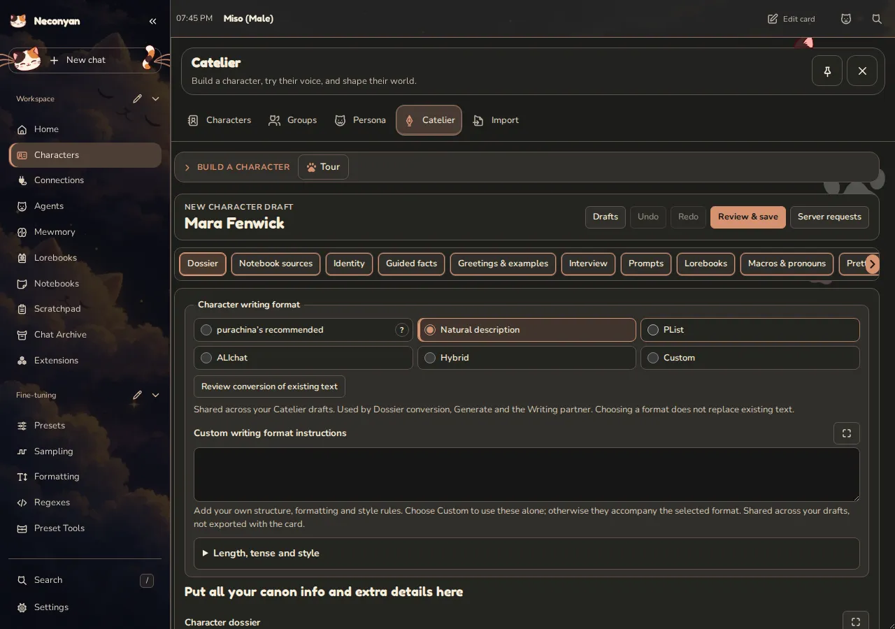
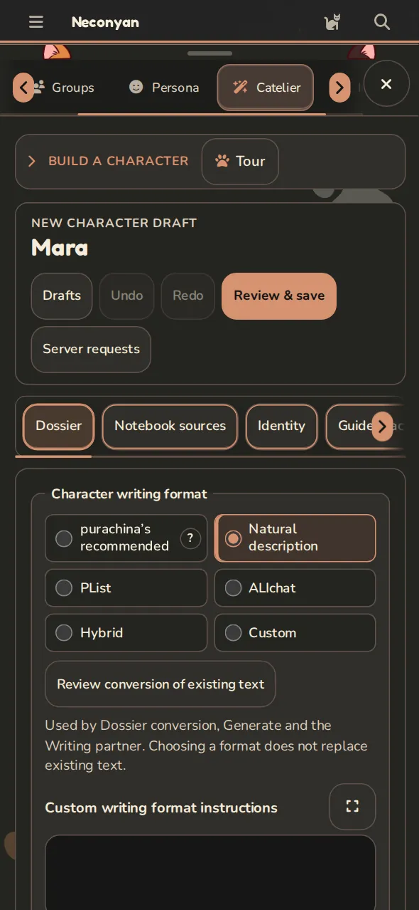

# Catelier

Catelier is where you build character cards. Write one yourself, ask a model to help or revise a card you already have. Your work stays in a private draft until you save it to the library.

## Make your first draft

1. Open **Characters → Catelier**.
2. Choose **Create a character**, or pick an existing card to edit.
3. Start with a name and an idea in **Dossier**. Add the character's description, personality and situation in **Identity**.
4. Write an opening in **Greetings & examples**. Give the other person something to answer.
5. Choose **Review & save**, check the changes, then **Save to library**.

**Save as a new copy** keeps the existing card. Reopen unfinished work under **Your drafts**. Discarding a draft doesn't delete a published character.

**Review & save** writes a version 3 character card (CCv3), with complete public fields and its embedded portable lorebook when it has one. JSON export writes the same format. An older imported card keeps its original shape in the comparison until you save or export it.

=== "Computer"

    <figure class="screenshot" markdown>
    
    <figcaption>Writing instructions are saved to your account and used by every Catelier draft.</figcaption>
    </figure>

=== "Phone"

    <figure class="screenshot screenshot--phone" markdown>
    
    <figcaption>Prefill and Stream live output are shared too, so the same choices follow your drafts on a phone.</figcaption>
    </figure>

## Ask for help with the writing

Choose a connection in **Writing instructions**. Add fallback profiles if you want another connection tried when the first fails. Generated writing uses your model account; typing your own text makes no request.

**Length, tense and style** sets the format, rough length and point of view. **Number of greetings** includes the first greeting and its alternatives. Use **What each greeting should do** to ask for different openings rather than several versions of the same scene.

Turn on **Ask questions first** to fill in missing details before a dossier or writing proposal. Answer what you want, then choose **Generate**.

## Settings shared by every draft {#shared-settings}

**Writing instructions** are saved to your account and used by every Catelier draft. That includes the connection, fallback order, **Maximum output tokens**, **Prefill**, **Stream live output**, **Length, tense and style**, **Number of greetings**, **Director prompt**, **Grounded prose prompt**, **Macro guidance prompt**, **NSFW instructions**, **Fields to create** and **Custom user instructions**.

**Prefill** starts the model's reply with text you set. Your provider must support assistant prefills. Kimi K3 and K3.1 Pro models also show **Partial prefill**, used instead of Prefill and sent as a partial assistant prefill; leave it blank to use Prefill. Each fallback connection uses the prefill for its own model. **Stream live output** shows text and available thinking while the reply is written; chat and text completion connections support it, and other connections show the finished reply.

**Custom user instructions** are directions for Catelier's writing, generation and interviews. They are shared across your drafts and aren't exported as the character's prompt.

Under **Identity**, the **Creator** field is shared too. Changing it updates the creator name for your other Catelier drafts; it doesn't publish or rewrite their cards until you save them.

Under **Portrait**, **Image prompt guidelines (optional)** and the **Image provider supports negative prompts** switch are shared across drafts. The **Portrait prompt** and **Negative portrait prompt** stay with each draft.

## Keep only the changes you want

Read a proposal before accepting it. **Accept this field** keeps one part; **Regenerate this field** asks for another attempt. Use **Accept all fields** or **Reject proposal** for the whole result.

Accepted text still belongs to the draft. **Review & save** is the separate step that changes your library. If the library card changed while you were working, use **Compare with library** before deciding what to keep.

## Add lore and switchable traits

**Lorebooks** holds the world details that belong with the character. **Notebook sources** can supply reference material you choose to share. Review proposed lore before publishing it.

Under **Prompts**, **Purrks** adds switchable traits, moods and instructions. A Purrk can stay active, use a manual switch, respond to a keyword or follow Scene AI. **Extract from card** finds existing traits and Orb fragments without a model request and starts them off. **Generate Purrks** asks a model for suggestions.

In a chat, **Chat tools → Character Purrks** opens their controls. System-prompt and after-history placements follow your **Prefer character prompt** settings. Check which Purrks are active if the character's behaviour surprises you.

## Come back later

With **Where replies are written → On the server**, submitted Catelier writing can continue after you close the page. Return to the draft or **Server requests**, collect the result and review it. **Cancel** stops the work; closing the page doesn't.

If you've edited the draft meanwhile, the saved result stays available for review rather than overwriting your newer text. The server still needs to remain running. Browser-written requests don't have the same closed-page behaviour.

For a quick conversation about an idea, try [Scratchpad](scratchpad.md). For ordinary card fields and imports, see [Characters and personas](../workspace/characters.md).
