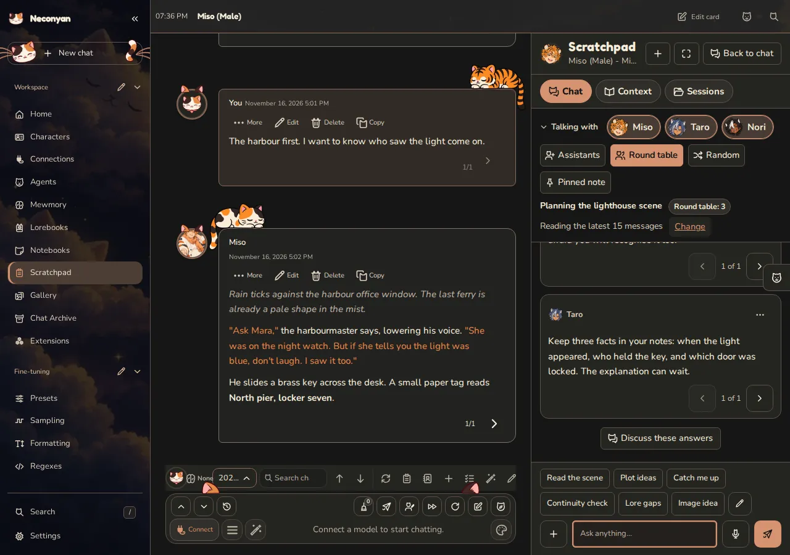

# Scratchpad

Scratchpad is a side conversation for ideas, continuity checks and proposed edits. Talk with Miso, Taro, Nori or an assistant of your own. The discussion doesn't become part of the story.

=== "Computer"

    <figure class="screenshot" markdown>
    
    <figcaption>Discuss the scene without adding the planning to it.</figcaption>
    </figure>

=== "Phone"

    <figure class="screenshot screenshot--phone" markdown>
    
    <figcaption>A round table keeps each assistant's reply separate.</figcaption>
    </figure>

!!! info "New in 1.5.5"
    Quick prompts of your own, typed tools, dictation, **Read aloud**, **Read links**, session pins, branching, export choices, **Review all**, **Discuss these answers**, **Saved setups**, **Pinned note**, **Rehearse next reply** and the extra change cards are new in 1.5.5. I've reviewed this guide against the published [Neconyan 1.5.5 release](https://github.com/platberlitz/Neconyan/releases/tag/v1.5.5) at commit **680a05f1** on 15 November 2026. These controls won't appear in 1.5.4.

!!! info "New in 1.5.6"
    **Feedback tone**, **Current preset** in General, saved pictures for vision models, answering your last message with an empty **Send**, and Saved setups for new sessions came in [Neconyan 1.5.6](https://github.com/platberlitz/Neconyan/releases/tag/v1.5.6). I've reviewed this guide against that release at commit **d3f33f5d** on 19 November 2026. They won't appear in 1.5.5.

!!! info "New in 1.6.0"
    The **Sharing**, **Replies** and **Setup** tabs under **Context**, problem checks, `/check` and `/why`, **App diagnostics**, **Neconyan source code**, **Share with the assistant**, **Try first**, **Undo** and **Change history**, **Queue follow-up**, **Talk mode**, **Compare with a second connection** and up to eight lorebooks in General are new in 1.6.0. I've reviewed this guide against the **1.6.0 staging candidate** at commit **73555b9c** on 27 November 2026. 1.6.0 isn't published yet, so these won't appear in 1.5.7.

## Open a discussion

1. Open **Scratchpad** from the workspace or chat tools, or **Ask Scratchpad** from a notebook note.
2. Choose an assistant under **Talking with** and a connection.
3. Check **Show preview** to see what you're sharing, then send your question.

From Home, **General Scratchpad** starts without hidden chat context. Quick prompts such as **Plot ideas** and **Continuity check** fill the message box for you to edit and send. Ordinary discussions don't need special tool-call support from the model.

On a phone or a narrow desktop panel, the header buttons move below the heading when they need room, and longer headings wrap instead of covering them.

From 1.5.6, if General has no persona selected, Scratchpad shows one warning. Pick a persona in **Personas** if you want to share it, or carry on without one.

If you delete an assistant reply and your own message is left last, press **Send** with the message box empty to have it answered again. Your message and attachments stay as they were, and no copy is added.

From 1.6.0 you don't have to wait for a reply to finish. While one is being written, the button is **Stop** while the box is empty. Type something and it becomes **Queue follow-up** (Enter does the same on a computer). Queued messages wait in a **Queued next** strip, up to five per session, and go out in order once the replies finish. You can edit or remove one before it goes. The queue pauses if you stop a reply, a reply fails or you switch chats; press **Send now** when you're ready to carry on. It only lives in that browser tab.

### Choose how honest the feedback is {#feedback-tone}

The **Feedback tone** slider under the assistant picker sets how hard the assistants judge your writing and ideas. Drag it, use the arrow keys, or press a stop under **Context → Replies → Feedback tone**:

- **Nicer** leads with what works and suggests one or two gentle fixes.
- **Neutral** is each assistant's usual honest feedback. New sessions start here, and older sessions stay here.
- **Harsher** leads with the biggest problem and holds the work to a professional standard.
- **Unreasonably critical** is impossible to please, played for laughs. Every complaint still names the line and comes with a real fix.

The mockery is aimed at the writing, never at you. If you sound genuinely upset or ask them to stop, they drop the act. Each assistant keeps their own voice at every stop, and facts, app help and change cards stay accurate.

In a round table everyone uses the shared tone. **Context → Replies → Feedback tone → Give one assistant its own tone** lets one assistant differ, such as a kind Miso beside an unreasonably critical Taro. **Same as shared** follows the slider again. When the shared tone isn't **Neutral**, the folded **Talking with** bar shows it as a badge. The tone is saved with the session, and rehearsals ignore it.

### Save your own quick prompts {#quick-prompts}

Press the pencil button at the end of the quick prompt row, **Edit quick prompts**, to open **Your quick prompts**. There:

- **Add a prompt** creates a row with **Name on the button** and **Text it fills in**.
- **Move up** and **Move down** change the order.
- **Delete prompt** removes one.
- **Save quick prompts** stores the list.

Your prompts appear ahead of the built-in ones in every Scratchpad, on every device signed in to the account. Pressing one only fills the message box. You can keep up to 24, and they aren't part of session exports.

### Settle dice and sums before sending {#typed-tools}

Start a line of your message with a typed tool. Scratchpad swaps that line for its result before sending. The assistant then reads a settled outcome instead of inventing one.

| Type | Result |
| --- | --- |
| `/roll 2d6+1` | Rolls the dice and shows every die. A note can follow, as in `/roll d20 for stealth` |
| `/calc 12*(3+4)` | Works out the sum |
| `/pick tea | coffee | cocoa` | Chooses one at random. Commas work too |
| `/now` | Writes today's date and time |

The rest of the message is sent as typed, and lines inside a code block are left alone. If a line can't be worked out, a notice headed **Nothing was sent** explains why and your text stays in the box. Send `/tools` alone to see the list. All of this happens in the browser, so it needs no tool-calling model.

### Dictate a message or hear a reply {#dictation}

Press **Dictate**, the microphone button beside Send, speak, then press **Stop and transcribe**. The words are added after anything already in the message box, and nothing is sent until you press Send. A recording stops by itself after two minutes. The button only appears in browsers that can record from a microphone.

**Context → Setup → Dictation and voice → Transcription service** chooses who turns the recording into text. **This server (Whisper, no key needed)** is slow the first time while it fetches its speech model. OpenAI, Groq and Mistral use the key saved for that service and receive the recording.

To listen instead, open an assistant reply's message actions and press **Read aloud**. It uses the text to speech voice mapped to that assistant's name. If there isn't one, it uses the default voice. It skips change cards, code blocks and link addresses. **Stop reading** stops it. Text to speech must be switched on with a voice chosen. If it isn't, the button says what's missing.

From 1.6.0, **Talk mode** sits between **Dictate** and **Send** for a spoken back-and-forth. It shows **Listening…** and then **Hearing you…**. When you pause, your turn is transcribed with the same transcription service and sent, the reply is read aloud, and it listens again. **Send now** ends your turn early, **Interrupt** cuts a reply short and **End talk** stops. The microphone is released between turns, and talk mode stops by itself after 20 seconds without speech or three empty turns. **Talk mode pause** under **Context → Setup → Dictation and voice** picks how long a pause ends your turn: **Short**, **Normal** or **Patient**. With text to speech off, replies just appear as text.

## Add files and images {#scratchpad-attachments}

Press **+** (Message options) beside the message box and choose **Attach files**. You can attach up to eight files to one message, with or without typed text. Each original file can be up to 32 MiB. After resizing and text extraction, the attachments on one message can total 2 MiB.

What happens depends on the kind of file:

- Images are resized to at most 2048 pixels on the longest side. Choose PNG, JPEG, WebP, GIF or another image your browser can open. Neconyan converts it to PNG or JPEG before sending. Image attachments need a Chat Completion connection with a model that accepts images.
- Text files, JSON, CSV and Markdown are read as text, up to 1 MiB.
- PDFs use selectable text, up to 300 pages and 1 MiB of extracted text. A scanned PDF needs its pages attached as images.
- Other binary files are refused rather than sent as broken text.

Press the **X** beside an attachment to remove it before sending. Attachments stay with their message. Later in the session, they're included as part of the earlier conversation. Draft attachments survive switching sessions while the page stays open, but not a browser reload. Session exports include attachments only when you tick **Attached files and images**, so keep the originals.

## Add your own assistant

Open **Assistants → Your assistants**. **Add a new assistant** takes a name and personality, with an optional picture and example dialogue. **Use a character card** makes an independent assistant copy. Later edits to the card don't change it.

**Edit → Save assistant** changes future replies. Deleting an assistant removes it from your library, but old sessions keep the copy they used. You can keep up to 24 assistants.

## Check exactly what it will read

From 1.6.0, **Context** opens with **What Scratchpad will read**, a short line of labels such as the number of messages, the card, your persona and any lorebooks, plus **Show preview**. Below it are three tabs:

- **Sharing** holds **Chat messages**, **Story and lore** (cards, **Your persona and Scenario Notes**, Author's Note, Mewmory, lorebook entries and **Current preset**, which used to sit under **Also share**), **Saved notes**, **Diagnostics**, **Tools and styling** and **Saved setups**.
- **Replies** holds each assistant's connection and prompt, **Compare with a second connection**, **Feedback tone**, reply length and streaming, **Automatic summary** and **Reply prefills**.
- **Setup** holds your global user instructions, **Web search** and **Dictation and voice**. It works without a chat open.

The tab you used last opens next time on that device.

**Show preview** lists the current context. Choose recent or selected messages and optional cards, **Your persona and Scenario Notes**, lore or Author's Note. Shared character cards are included as saved, including their greetings, examples and instructions.

**Sharing → Story and lore → Current preset** adds your preset separately, with prompts marked on or off. It starts off. In Roleplay and, from 1.6.0, Conversation, sharing it also lets the assistant propose edits to the selected preset. In Conversation it reads the active preset with your account's prompt order, and prompt order edits go there. [Review a proposed change](#review-a-proposed-change) covers that.

Important boundaries:

- **General** shares no chat or swipes, and no lore until you pick a book under **Share a lorebook**. You can explicitly share a selected card, persona and permitted notes. From 1.5.6, General also offers **Current preset**, named after your equipped preset and off to begin with. There it's reference only. It doesn't change the assistant's instructions or offer edits to the preset.
- Picked messages stay tied to their original chat. Switching chats doesn't substitute different messages.
- Scratchpad doesn't automatically read Mewmory or Companion notes. In a Roleplay chat you can tick **Mewmory** under **Sharing → Story and lore**, and **Companion notes** under **Sharing → Tools and styling**. See [Share saved memories or a lorebook](#share-memories-or-a-lorebook).
- A linked note isn't automatically shared. Notebook permissions still apply.
- **Ask Scratchpad** from a note shares that note or selection for 30 minutes after confirmation. It doesn't add the story beside it. Tick **Allow proposed edits to the shared text** for suggestions, or use **Stop sharing** to end access.

Context and note permissions are checked again when you send. Removing permission can't withdraw text already sent to a provider.

### Share saved memories or a lorebook {#share-memories-or-a-lorebook}

In a Roleplay chat, tick **Mewmory** under **Context → Sharing → Story and lore** to let the assistant read that chat's saved [Mewmory](mewmory.md) records. It starts off. Pinned memories come first, then recent ones, up to 128 records and 96 KiB. **Show preview** lists exactly which were sent and how many were left out. Reading never extracts new memories, runs recall or edits a record. Conversation, General and note discussions don't read Mewmory.

General Scratchpad has no story, so it shares no lorebook until you choose one under **Context → Share a lorebook**. From 1.6.0 you can pick up to eight from the **Add a lorebook** list, and **Remove** takes one off again. The picks belong to that session. Always-active entries are shared. Other entries are shared when their keywords appear in the Scratchpad conversation. Entries hidden from assistants stay hidden. The assistant can then suggest adding, editing or deleting entries in those books only.

### Reuse your Context choices {#saved-setups}

**Context → Sharing → Saved setups → Save current choices** keeps a session's Context choices under a name. In any other session, pick it under **Saved setup** and press **Apply setup**. Saving under an existing name replaces it, and **Delete setup** removes one. You can keep up to 24.

A setup holds **Recent messages to read**, the **Story and lore** ticks, hidden-message sharing, streaming, the longest reply, Web search, Read links and reply prefills. Picked messages, lorebook entry choices, saved notes, connections, assistant prompts and the round table stay as they are.

From 1.5.6, the setup selected under **Saved setup** also applies to every new session, including temporary ones and the first session in another chat, note or General. This device remembers the selection. **Apply setup**, **Save current choices** and **Delete setup** keep your scroll position. The setup also stores the shared **Feedback tone**.

### Keep a pinned note {#pinned-note}

Press **Pinned note** beside the assistant controls, write your goals, scene details or loose ends, and press **Save note**. Every reply in that session reads the saved note, and **Show preview** includes it. You edit it by hand; assistants don't update it. It holds up to 16 KiB, and saving an empty note removes it.

New sessions start blank. Branches, copied sessions and exports keep a copy. The note doesn't change the story or create a notebook page.

### Summarise a long discussion {#automatic-summary}

Under **Context → Replies → Automatic summary**, tick **Summarise older discussion**. It starts off. Once a discussion passes 50 usable messages or its history allowance, the first replying assistant summarises the older turns with its own connection. The latest 20 messages usually stay in full. **Last saved summary** shows the text and how many messages it covers.

Every saved message stays in the session. Summarising makes extra model requests, can miss details and doesn't look at attached images. If it fails, the reply stops with an explanation rather than quietly dropping history.

## Check a card, preset or lorebook {#check-a-card-preset-or-lorebook}

From 1.6.0, Scratchpad can check your work and help when something in Neconyan goes wrong. Everything here sits under **Context → Sharing → Diagnostics**, starts off and is saved with the session.

- **Problem checks** runs fixed checks in your browser on the shared card, the shared **Current preset** and each shared lorebook. These aren't model guesses. **Show preview** adds a **Checks** list naming each problem, where it is and why it matters. The quick prompts **Check my card**, **Check my preset** and **Check my lorebook** switch on what they need and fill the message box.
- With a lorebook shared, Problem checks also traces why entries wouldn't fire, one reason per entry, without any model request. Ask **Why didn't an entry trigger?** and the assistant can suggest new keys or activation settings as a change card.
- **App diagnostics** gathers your version, recent browser errors, crash reports, failed requests and, for an admin, server crash reports. Keys, tokens and chat text are removed first. The quick prompt is **What went wrong in Neconyan?**
- **Neconyan source code** lets the assistant read Neconyan's own code, read-only, to find a bug. Your config, secrets and data folder are never readable. It cites the files it checked and can write a **Bug report draft** with **Copy bug report**. Nothing is submitted for you.
- **Last prompt sent** (Roleplay and Conversation) shares the exact prompt behind the last reply, with secrets redacted.

You can also type these as shortcuts at the start of a message: `/check card`, `/check preset`, `/check lorebook`, `/check app`, `/check source` or `/check prompt`, or `/why` followed by an entry's name or key. Scratchpad switches on only what that check needs and sends the plain request. `/check` alone lists what you can check right now. If something is missing, a **Nothing was sent** notice says what to share, and your text stays in the box.

When an assistant can't answer properly without something you haven't shared, its reply can show a **Share with the assistant** card with its reason and a ticked box per item. **Share & continue** switches those on and carries on, **Turn on** only switches them on, and **Not now** leaves everything as it was. Untick anything you'd rather keep private.

The diagnostics go to the provider behind your Scratchpad connection, so I'd only switch them on with a provider you trust with that information.

## Search the web

Choose a provider under **Context → Setup → Web search**. Brave, Exa and Tavily need their own keys. NanoGPT uses your saved key. SearXNG needs an instance with JSON output enabled. Custom search addresses must return supported JSON results.

Open **+** (Message options) beside the message box and turn on **Web search**. The choice is saved with the session.

From 1.5.5, the reply model writes the search queries itself, using your message and the last few Scratchpad messages. It reads the results and searches again until it has enough. It stops after four rounds or ten queries. The search service receives only those queries. Your chat, cards, persona and notes never go to it. **Results to read** is the total kept across every search, from 1 to 30, and starts at 5. Press **Save web search** after changing the provider settings.

The research runs once for the whole round table. Replies cite numbered results and keep a folded **Sources** list with the queries used. If search fails, the assistants can still answer, with a notice. **Stop** cancels an active search too. Search providers may charge for each search, and several searches per message add up.

### Read the pages you link {#read-links}

Turn on **+ → Read links** and Scratchpad reads up to three web pages linked in the message you send, before the assistant answers. It starts off, is saved with the session and needs no provider or key. Only links you typed are read, never links found inside a page. Each page contributes its text, up to about 12 KiB.

The reply keeps a folded **Pages read** list, with the reason beside any page that couldn't be read. Private and local addresses are always refused. Pages drawn entirely by scripts give little or no text. Web search finds pages for you. Read links reads the ones you already have.

## Ask more than one assistant

Turn on **Round table** and select up to three assistants. Each answers with its own connection and reply limit, without seeing the others' answers from that round. Ask a follow-up to compare their ideas.

**Random** asks just one selected assistant per message. Turn it off to ask everyone again. Each answer can be a separate paid request. **Stop all** stops the round, and you can retry failed participants one at a time.

Once at least two assistants have answered your latest message, **Discuss these answers** appears under the round. Each selected assistant reads the others' answers and replies again: where they agree, where they disagree and what they'd change. Anything typed in the message box goes along as the point to focus on. The button is absent in Random mode, and a discussion round never runs a web search or reads links. It costs another request per assistant.

From 1.6.0, **Context → Replies → Assistant connections → Compare with a second connection** asks the same assistant twice, through two different connections, for every message. Pick **Same connection as the chat** or a saved connection profile. The two connections must differ, or Scratchpad won't send. The header says **Compare: 2 connections**, each reply carries its connection's name, and **Keep only this reply** keeps the one you prefer. It's off while **Round table** is on, and it's saved with the session and in Saved setups. Each message then costs two requests.

## Keep alternative replies

**Try again** saves a new version of that assistant's reply instead of discarding the previous one. From 1.5.5 it works on any reply to one of your messages, not only the latest, and later messages stay as they are. Use the arrows and version counter below the reply to choose an alternative. A reply can keep up to 50 versions. Other round-table answers stay as they were.

Under **Context → Replies → Reply prefills**, **Reply prefill** starts the assistant's answer with text you supply. It applies to every assistant in the session, including new reply versions, and needs a connection that supports prefills. Leave it empty for normal replies. **Kimi K3 / K3.1 partial prefill** takes precedence for those models. An unclosed `<think>` only starts the thinking and isn't added to the saved reply.

## Try the next story reply first {#rehearse}

With a Roleplay or Conversation chat open, choose **+ → Rehearse next reply**. Type directions first, or leave the box empty. The selected assistant drafts a continuation from the shared Context with its own connection. The result is labelled **Rehearsal**, stays in Scratchpad and doesn't advance the story. It offers no change cards, and **Try again** keeps rehearsing. General and note discussions have no rehearsal control.

This isn't the normal story generation, so I'd treat the draft as a sketch. **Show preview** shows the story material it was given.

In a Roleplay chat, an assistant reply's message actions also have **Add as another version of the last story reply**. Scratchpad asks first:

- **Add version** adds the reply, without its change cards, as a new swipe (an alternative version) of the character's last story reply and shows it. The earlier versions stay, so you can swipe back.
- **Not now** adds nothing.

Adding is refused when:

- the chat has no reply yet
- the last story message is yours or hidden
- the story changed while you were deciding
- a story reply is being written

Conversation chats keep **Use as draft in the chat box** instead.

## Preview HTML and CSS

Choose **Preview HTML/CSS** beside a code block to see the HTML with the CSS blocks in that reply. The same button appears in a supported proposed-text review. CSS without HTML is shown on sample content.

The preview is static. Scripts, external resources and links are blocked, macros stay as written, and nothing is saved. Close it to continue editing, or review and save the proposed change separately.

## Review a proposed change

An assistant can propose changes to supported cards, lorebooks, chat messages, the shared preset and notebook notes. Open **Review**, compare **Now** with **Proposed text**, then choose **Save change**. A proposal appearing is not a save.

With **Your persona and Scenario Notes** shared, it can also change the persona's name, description or title, or an existing note's name or text. Persona edits change the saved base fields in every chat. Note edits affect every chat using that note and keep its activation. It can also draft a brand-new persona or note. [Create a persona or Scenario Note](#create-a-persona-or-scenario-note) covers that.

With **Current preset** shared in Roleplay or Conversation, the assistant can replace one field in the selected preset:

- For Chat Completion, that can be one prompt module's text, name, role, on/off state, in-chat position or depth. A slot filled from the card, chat or persona can only be switched on or off.
- For Text Completion, it can be one field from the saved system prompt, context template or instruct template.

Review the change as usual. **Save change** writes the selected preset, including its current settings, so other chats using that preset get the change too. Sampler, connection and other preset settings aren't available to the proposal, and each proposal changes one field. If the original preset is no longer selected or shared, the review refuses to save.

Version 1.5.5 adds more kinds of change card. Each needs its box ticked under **Context → Sharing**, starts off, and stays ticked while you review:

| Share | The assistant can suggest… | It can't… |
| --- | --- | --- |
| **Agents** | One saved Agent's name, description or prompt | Create or delete an Agent, switch one on or off, or change its other settings |
| **Author's Note** (Roleplay) | A new text for this chat's note. An empty suggestion clears it | Change where or how often it's inserted, or the character, persona and default notes |
| **Regexes** | One global script's name, Find pattern or replacement | Create, delete, reorder or switch a script, or edit character and preset scripts |
| **CSS Snippets** | One snippet's name or CSS | Create, delete or switch a snippet, or change where it applies |
| **Dialogue Colors** | One character's dialogue colour | Add or remove a character, or change gradients, fonts and groups |
| **Mewmory** (Roleplay) | A correction to one shared memory's text or status, as a **Correct memory** card | Correct excluded or hidden memories, Pawspective interviews or overviews |

A change is refused if its target was edited after the proposal was made. Review a fresh suggestion instead. An invalid Find pattern, or CSS the browser can't read, is refused too. A saved memory correction counts as your own edit, and Mewmory keeps the earlier version.

When one reply holds two or more open cards that edit something existing, **Review all N changes** appears under them. It lists every change with a tick box, its comparison and **Edit the proposed text**. Untick what you don't want and press **Save ticked changes**. Each change is checked again before it's written. One that no longer fits is skipped: its card stays open and a list says why. Picture cards, notebook changes and cards that create something new keep their own **Review** button.

You can adjust supported non-notebook proposals before saving. Notebook changes save the exact reviewed proposal, so ask for a revision if needed. If the original changed meanwhile, reopen or regenerate the proposal rather than overwriting newer work.

Message edits apply to the chat they came from, so return to it to review them. Roleplay can rewrite, add, hide, unhide or delete messages. From 1.6.0, Conversation can rewrite, add or delete messages in the open branch, but never hides them, and it waits while a Conversation reply is being written. **Use as draft in the chat box** fills the composer without sending.

### Try a change first, or undo it {#try-or-undo}

From 1.6.0, **Try first** sits beside **Review** and **Dismiss** on a change card. It rehearses the next story reply with the change already in place and saves nothing. In the review, **Try before saving** does the same with your edited text. The reply is labelled **Rehearsal · Unsaved change**, and the card stays open, so you can save it once you like the result. It works in Roleplay and Conversation for card text, persona text, lorebook entries, preset fields and messages, plus Author's Note in Roleplay.

After a save, **Undo** appears beside **Saved**. It puts the previous text back, the card says **Undone**, and **Review again** reopens the suggestion. Undo first checks nothing else has changed the target since. If you've edited it, Undo stops so your later work stays, and **Copy previous text** lets you restore the old text by hand.

**Sessions → Change history** lists the last 50 saved changes, newest first, each marked **Saved**, **Undone** or **Recorded**, with **View before & after**, **Copy previous text** and **Undo**. New characters, pictures and notebook changes are only recorded. The history survives a reload but isn't part of a session export.

## Create a character

Ask for a character and review the **New character card** proposal. Adjust its structured draft if needed, then **Save change**. Wait for **Saved** before looking in Characters.

A generated avatar is optional and needs Quick Image Gen configured. For a dedicated workspace with field-by-field revisions, use [Catelier](catelier.md).

## Create a persona or Scenario Note

Ask an assistant for a new persona and it drafts a name, description and title, even when you haven't shared a chat or a persona. Review the **New persona** proposal and press **Save change**. Nothing is saved before that press. Wait for **Saved**, then open **Persona**. The new persona is there with the default portrait, and the persona you're using stays selected.

To draft a new Scenario Note instead, share **Your persona and Scenario Notes** and ask for a note on the shared persona. **Save change** saves the note without switching it on in any chat. It waits under **Persona → Scenario Notes** for that persona until you choose where it applies.

The review shows the draft as JSON, a structured text format, which you can adjust before saving. It holds the name and description, with the title for a persona or the note's own label and text. Macros in a draft stay exactly as written. Saving the same suggestion again doesn't create a duplicate, so retrying a save that failed won't leave two copies behind.

## Images and portraits

**Image idea** drafts a request. **Generate image** starts the image request using Quick Image Gen settings. If prompt review is enabled, approve **Generate reviewed image** first.

From 1.5.7, new picture and avatar requests use Quick Image Gen's **Image count**, up to ten. For an avatar batch, press **Use as avatar** under the result you want to review. The other pictures stay in the reply.

Generating a picture doesn't replace a portrait. **Review avatar** compares the current portrait with the proposed one and **Save change** applies the replacement to the exact shared card. **Previous avatar** opens the preserved original PNG. It isn't a one-click undo.

With **Your persona and Scenario Notes** shared, the assistant can also propose a persona avatar or one saved Scenario Note's avatar. The review shows **Current avatar** and **Proposed avatar**. **Save change** makes the picture live. A persona avatar replaces the portrait across chats and keeps the persona's saved details. A Scenario Note avatar applies while that note is active. Ask the assistant to remove its portrait to return to the normal persona picture. The note's text and activation stay as they were.

To change a picture you attached or one Scratchpad generated earlier, ask in plain words. The assistant proposes an **Edit image** card that names the picture it starts from. Pressing **Edit image** sends that picture and your request to the Quick Image Gen provider and saves the result as a new picture. The original is kept. Editing needs a provider that accepts a picture as input: GPT Image and Responses image models, Gemini, compatible NanoGPT models, a local A1111 server, or a custom or proxy service that takes reference pictures. Each edit is a paid image request.

Models that can see images are also shown up to four recent generated pictures on follow-up messages, so 'make the coat darker' has something to look at.

From 1.5.6, this works even with the regular chat image setting off. Custom and CometAPI models are always offered the pictures. If the provider refuses them, the reply is retried once with short text notes instead, and Scratchpad remembers that model as text-only until the server restarts. Text-only models get the picture's prompt and status, not the picture.

To fix a portrait, name the character, persona or Scenario Note avatar it should replace when you ask for the edit. The **Edit image** card then targets that avatar. When it finishes, **Review avatar** and **Save change** work as they do for a new portrait. The edited picture stays separate until you save it.

Image work can continue on the server after you close Scratchpad. **Stop image** requests cancellation. Use **Retry saved job** for retained work rather than buying another image when only local saving failed. If the provider's outcome is unknown, the image isn't bought again automatically.

Download pictures separately, and keep the original files you attached. Session exports keep text and image prompts, not generated pictures, jobs or approvals. Attached files are included only when you tick them in the export.

## Edit an assistant's instructions

Use **Context → Assistant prompts → View or edit…**, then **Save prompt**. These instructions belong to Scratchpad, not the ordinary character card. **Reset to default**, followed by **Save prompt**, restores the built-in wording.

Permission rules still apply. Editing an assistant prompt doesn't grant access to private notes.

## Give every assistant the same instructions

Open **Context → Global user instructions → Edit user instructions**. Choose all assistants or selected ones, write your preferences and **Save instructions**.

These account-wide instructions follow you across devices and discussions. A reply already running keeps its original instructions. Save an empty value to turn them off. Session exports don't include them.

## Streaming and reply length

**Context → Stream replies** shows text and available thinking as they arrive. Fold **Thinking** if you only want the answer. Turn streaming off to wait for the complete reply.

**Longest reply (tokens)** limits output in tokens, the units of text a model counts. That includes thinking on models that count it there. New sessions start at 32,000. Existing sessions keep their value. Output and thought counts show what the provider reports.

If **Scratchpad is full** appears, export anything you need, then remove old sessions or long replies. The [full reference](https://github.com/platberlitz/Neconyan/blob/staging/docs/scratchpad.md) lists storage limits.

## Sessions and saved results

Open **Sessions** to find, start, pin, export or import a discussion. Roleplay sessions follow the character across chats. Groups have their own list. Conversation keeps separate lists for each persona. Note discussions belong to the note, and General has its own account list.

Server-backed replies can continue after closing the page while the server stays available. Switching chats doesn't redirect an edit proposal to another chat.

A new session is named after its assistant, then renamed to the opening words of the first message you send. No model is asked, and a name you set with **Rename** is never replaced. **Pin session** on a session's row lists it first and keeps it out of automatic cleanup. A pinned session still counts towards the 40 per list.

**Search sessions** filters the list you have open. Type at least two characters and press **Search every list**, or Enter, to look through the sessions of your other chats, notes and General by name and message text. A found session belongs to another list, so **Copy here** copies it into the open list and leaves the original where it was.

### Branch a discussion {#branch}

Open a message's actions. On an assistant reply, **Branch into a new session from here** makes a new session holding the conversation up to and including that reply. On one of your own messages, **Reword in a new session** holds everything before it and puts its text in the message box to reword. The new session is named after the original with '(branch)' added and opens straight away. The original is unchanged.

### Choose what an export includes {#export}

**Sessions → Export current** opens **Export this session**. Under **File type**:

- **Scratchpad file** can be imported again and keeps every version of each reply.
- **Markdown** is a transcript for reading or sharing, with the chosen version of each reply. It can't be imported.
- **PDF / print** opens a print view in a new window. Press **Print / save PDF** and choose Save as PDF in the browser's print options. If the browser blocks the window, allow pop-ups for the site and try again.

Under **Also include**, tick **Thinking**, **Web search sources** or **Attached files and images**. All start off, so an untouched export holds conversation text only. Attachments make the file much larger. Message picks, saved-note sharing, approvals and generated pictures are never exported.

**Delete old sessions automatically** starts off. Enabling it asks you to confirm the number to keep across all lists. Deletions are permanent. The open session and active replies are protected. Export first if you may want the discussion again.

You can copy a message, selection or session to a notebook. This saves discussion text, leaving out reasoning and change cards, and grants no ongoing notebook access.

Each fenced Markdown block in an assistant reply has its own **Copy** button at the top right, with the tooltip **Copy Markdown**. It copies only that block's contents, without the surrounding fences or the rest of the reply. The **Copy** action on the message still copies the whole message.
