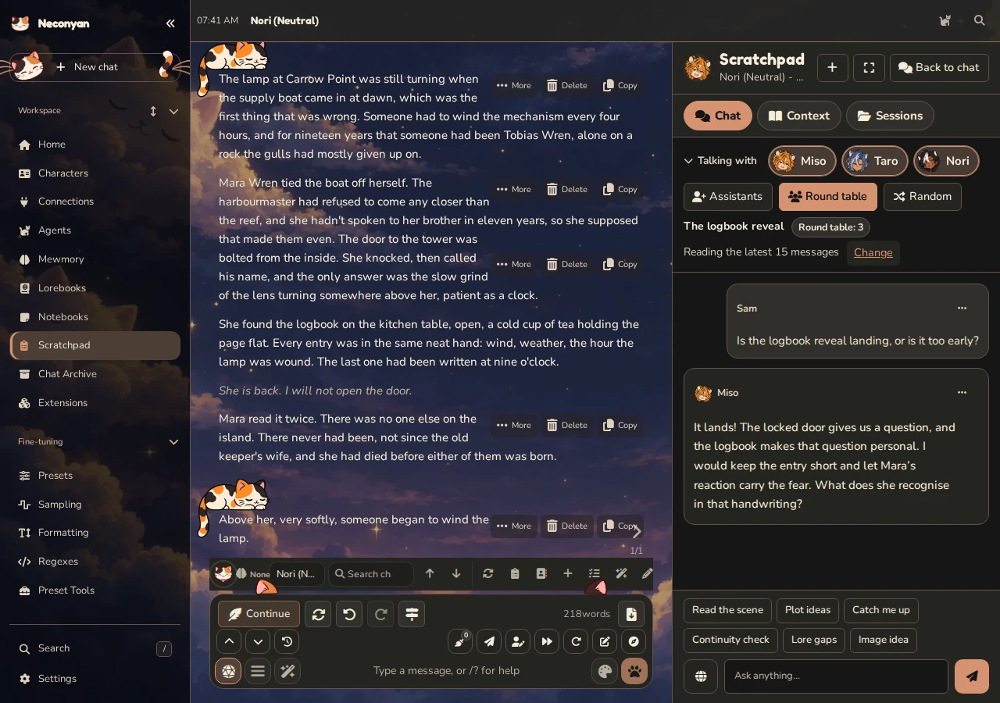
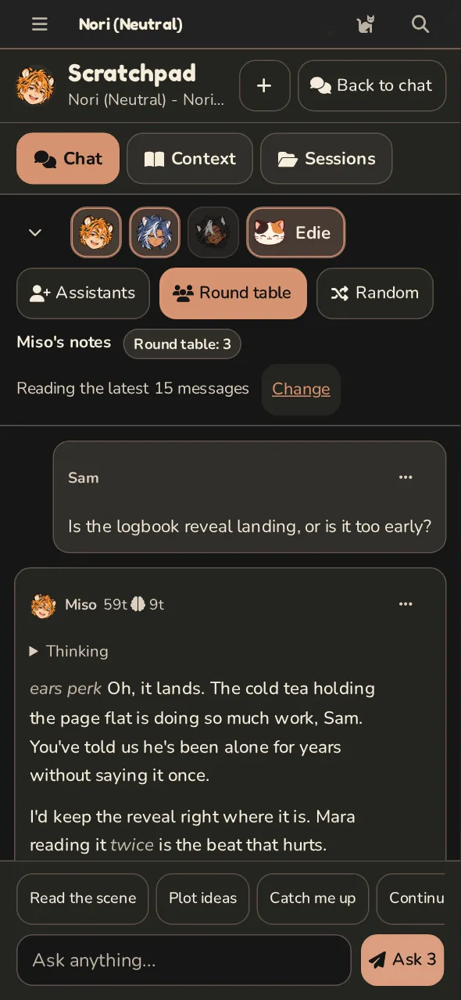

# Scratchpad

Scratchpad is a side conversation with an assistant you choose: Miso, Taro, Nori, a copy of a character card or someone you make yourself. Use it to discuss a scene, check continuity, brainstorm or propose edits without adding that discussion to the main story.

Every assistant stays in character while helping. Miso, Taro and Nori keep their own voices, and your own assistants use the personality you give them.

=== "Computer"

    <figure class="screenshot" markdown>
    
    <figcaption>A staged round table beside the story. Nothing said here goes into the chat.</figcaption>
    </figure>

=== "Phone"

    <figure class="screenshot screenshot--phone" markdown>
    
    <figcaption>On a phone Scratchpad fills the screen; Back to chat returns to the story.</figcaption>
    </figure>

## Open a discussion

Open **Scratchpad** in the workspace, through the chat tools or through **Ask Scratchpad** in Notebooks. On desktop it can sit beside the chat or use the full width. On a phone it uses the screen and provides a way back to the chat or note.

From Home, it opens **General Scratchpad**, with one account-owned session list and no hidden chat context. You can brainstorm, create a character or work with permitted notes without opening a story first. General stays separate from character, group and notebook discussions.

1. Use **Talking with** to select an assistant.
2. Choose the current chat connection, **Current connection** in General, or a separate connection profile.
3. Check **Show preview**, then type your question and send it.

Normal Scratchpad use works without a model's special tool-call support.

Quick prompts fill the composer with requests such as **Read the scene**, **Plot ideas**, **Catch me up**, **Continuity check** and **Lore gaps**. Read or edit the draft, then send it.

Each reply shows its output and thought token counts beside the assistant's name, labelled **Output tokens** and **Thought tokens**. The counts grow while the reply is written and stay on the saved reply. Thought tokens only appear when the provider reports the model's thinking.

## Add your own assistant

Press **Assistants** beside the portraits to open **Your assistants**.

- **Add a new assistant** asks for an **Assistant name** and a **Personality**. **Example dialogue (optional)** and **Choose picture** are optional. Pictures can be PNG, JPEG or WebP, under 16 MB, and are cropped to a square portrait.
- **Use a character card** searches your saved characters. **Add** copies the card's picture, description, personality and example dialogue. It doesn't copy the scenario, greetings, lorebooks or the card's own system instructions. The copy is independent: editing the card later doesn't change the assistant, and editing the assistant doesn't change the card.
- **Use** selects an assistant. In a round table it includes or leaves them out.
- **Edit** changes a saved assistant's name, personality, picture or example dialogue. **Save assistant** applies the changes to future replies across your account. **Delete**, inside **Edit**, removes them from your library after you confirm.

You can save up to 24 assistants. Names keep their first 80 characters, and the personality and example dialogue keep up to 64,000 bytes each, so a very long card is shortened to fit.

Sessions keep their own copy of each assistant they used. A deleted assistant still reads correctly in old sessions and shows **Only in this session** there. Session exports carry those copies, so an imported session keeps its assistants without adding them to your library; use **Edit** to save one.

Your own assistants work everywhere the included three do: round tables, connections, assistant prompts and global instructions. A session-specific prompt still takes priority over personality edits.

## Check exactly what it will read

Use **Show preview** before asking about private or large material. Context controls can include recent or selected chat messages, selected swipes and optional character, persona, Author's Note or lore content. Shared character cards are sent complete and exactly as saved, including greetings, example messages, creator's notes and the card's own instructions, with `{{char}}` and `{{user}}` left in place.

In Roleplay, **Also share** also has a **Current preset** box, labelled with your preset's name. It's off until you tick it, and once ticked the session and new sessions keep it. The preset goes in as its own section, separate from the cards, persona and lorebooks, so the assistants can tell which instructions come from where. With Chat Completion it lists every Prompt Manager module in prompt order, marked on or off, with its role, in-chat depth and text exactly as saved. Slots such as the character description or chat history are named but not filled in, so no card or chat text is repeated. With Text Completion it lists the system prompt, context template and instruct template. **Show preview** reports how many modules are on and off. Conversation mode doesn't use presets, so the box isn't shown there.

Selected saved notes follow notebook permissions. Linking to another note doesn't automatically include it. Scratchpad doesn't automatically read Mewmory records or Companion notes.

Story context is rebuilt from the open chat on each send. Saved-note text and permissions are also checked again on the server. The Context list updates when shared notes change during a session. If a note changes while a reply is being prepared, send again using the new version; unavailable, private or expired notes show **Not shared** without their text.

General shares no messages, swipes, lore, chat metadata, Author's Note or preset. You can explicitly share the selected character card, persona and permitted notes. A character edit must still target that selected, shared card. General supports new-character and permitted notebook proposals, but no message or lorebook edits.

Picked messages stay tied to their original chat. If you open another chat, Scratchpad sends neither those picks nor replacement recent messages. Clear the picks or select messages from the new chat before sending again.

Where notebook AI access is allowed, the preview also lists the notebook's name, access level, permitted actions and readable-note count. That list doesn't include note titles or contents by itself. Removing access can't withdraw material already sent to a model.

A discussion opened from **Ask Scratchpad** in a note is note-specific. It uses the shared note or selection and doesn't silently add the story beside it.

The note is saved before sharing; if autosave is already running, Scratchpad waits for it. The confirmation grants access to the chosen note or selection for 30 minutes without changing permanent notebook permissions. Tick **Allow proposed edits to the shared text** if you want edit suggestions. Use **Stop sharing** under Context to end that temporary access.

## Search the web

Press the globe button beside the message box (**Search the web for this message**) to look something up before the assistants answer. It's off by default, and each session remembers its own choice. The search service only receives the message you're sending, trimmed to 400 characters. Your chat, cards, persona, notes and earlier Scratchpad messages stay out of it.

Pick the provider once for your account under **Context → Web search**:

| Provider | What it needs |
| --- | --- |
| **Brave Search** | A Brave Search API key, added with **Manage Brave Search key** |
| **SearXNG** | Your own instance's address, with JSON output turned on in its `search.formats` setting. A 403 error usually means JSON output is off or the instance refuses this server |
| **NanoGPT (Linkup)** | Your saved NanoGPT key. It works even when the assistant uses another provider |
| **Exa** | An Exa API key, added with **Manage Exa key** |
| **Tavily** | A Tavily API key, added with **Manage Tavily key** |
| **Custom address** | Any search address that returns JSON. Put `{query}` where the search words go and, optionally, `{count}` for the number of results. Each result needs a `url` or `link` and a `title` or `name` |

A custom address can take a key through **Manage custom search key**. **Key header** decides where it goes: `Authorization`, the default, sends `Bearer <key>`, and any other header, such as `X-API-Key`, sends the key unchanged. A private or local address, for SearXNG or a custom service, has to be on the server's private address list, and only an administrator can save one.

**Results to read** keeps between 1 and 10 results, 5 to start with. If the globe is on but the provider or key is missing, nothing is sent and Scratchpad tells you what to set up.

Scratchpad searches once per message, or once for a whole round table, and waits up to 20 seconds. The assistants cite the results they use as `[1]`, `[2]` and so on. If the search fails, they still answer, with a note saying so. **Stop** also cancels a search in progress.

Finished replies keep a folded **Sources** list with the query and numbered links. The saved reply keeps the provider, query, titles and addresses, but not the result snippets. Session exports don't include sources.

## Ask more than one assistant

Round table mode lets you select up to three assistants. **Ask 2** or **Ask 3** sends to the selected assistants, each with its own connection and reply limit.

They answer concurrently, without seeing one another's answers from that round. Ask a follow-up if you want them to compare the ideas after the answers are available.

Each answer can mean a separate paid request. **Stop all** stops the round, and failed participants can be retried separately.

Turn on **Random** beside **Round table** for one reply per message. The send button becomes **Ask 1**, and one of the selected assistants answers at random, with their own personality and connection. **Try again** keeps the assistant who gave the answer you are replacing. Random is saved with the session; turn it off to ask everyone selected again.

Before you send anything, an empty session shows the portraits of every selected assistant.

!!! miso "Miso"
    Give each assistant a different job. A continuity check and a proposed complication will give you more to compare than duplicate requests.

## Review a proposed change

Scratchpad can offer change cards for supported characters, lorebooks, Roleplay messages and notebook notes. Open **Review** and read **Now** against **Proposed text**. **Changes** highlights additions and removals and updates as you edit the proposed text. Nothing is saved merely because a card appeared.

For supported non-notebook proposals, you can adjust the proposed text before **Save change**. Notebook proposals save the exact reviewed proposal; ask for a revised proposal if it needs changing. Scratchpad always requires review for notebook changes.

If the target changed after the proposal was prepared, saving is refused so an old suggestion doesn't overwrite newer work. Reopen or regenerate the proposal against the current content.

Message-edit proposals are available for Roleplay, not Conversation. Open the original chat to review or retry a request about one of its messages; changing chats cannot redirect that edit to a different message. **Use as draft in the chat box** places text in the composer without sending it.

## Create a character

Ask Scratchpad to create a character, including while discussing a shared notebook note. It returns a **New character card** proposal. Open **Review**, adjust the fields in the JSON draft, the structured text used for the card, then choose **Save change**. Check that the proposal says **Saved** before looking for the new card.

The draft can include the character's name, description, personality, scenario, first message, example dialogue, character note, instructions and alternate greetings. Leave `avatarPrompt` empty for the default picture. An explicitly requested generated avatar needs Quick Image Gen configured and can cost an image request.

If a model puts the character note or alternate greetings inside the character fields, or uses the saved-card spelling `alternate_greetings`, the review card still opens. Two different copies of the same field are refused, and Neconyan doesn't guess which one you meant.

Compatible Chat Completion models can use a creation tool. Models without tool calling can still return a change card for you to review and save.

## Images and portraits

Set up and enable **Quick Image Gen** first. **Image idea** fills an editable request; send it when you're ready. An assistant's image card proposes a prompt. **Generate image** starts the paid image request using your saved image settings. I kept generating a picture separate from replacing a portrait, because asking for one shouldn't quietly change a card.

An unnamed image uses global settings without borrowing the latest story message. A named image uses that shared character's saved image settings. If **Review before generate** is on in Quick Image Gen, pressing **Generate image** opens the processed prompt review window straight away, with **Stop image** hidden while the review is prepared; choose **Generate reviewed image** to approve it or **Cancel** to decline it before any image request is sent. Ask for another suggestion to change its wording.

The work continues on the server after you close Scratchpad. **Stop image** requests cancellation; finished pictures have **Open image** and **Download**. **Retry saved job** resumes retained work, reusing a saved provider result when only local saving failed. An unknown provider outcome isn't purchased again; check the provider before asking for another image.

For a portrait, use **Review avatar** to compare the current and proposed pictures. Only **Save change** replaces the portrait, after checking the exact shared card and its current revision. In General, that must still be the selected, shared card. **Previous avatar** opens the preserved original PNG, including its card data; it isn't a one-click undo.

Session exports contain text and image prompts, not pictures, jobs or approvals. Download pictures separately. Deleting a session removes its references, not the saved user-image files.

## Edit an assistant's instructions

Open **Context → Assistant prompts**, then **View or edit Miso's prompt**, or the equivalent for Taro or Nori. **Save prompt** applies the complete instructions to that assistant in the current session. New sessions in that character, group or note's session list inherit the choice. To restore the built-in instructions, choose **Reset to default**, then **Save prompt**.

These instructions belong to Scratchpad, not the assistant's ordinary character card. The product-help reference and notebook permission rules are still added automatically; editing the prompt doesn't grant access to private notes.

## Give every assistant the same instructions

For preferences you want everywhere, such as 'answer in British English', open **Context → Global user instructions → Edit user instructions**. Choose **All assistants**, or **Selected assistants** and tick the ones you want. Write your text in **User instructions**, then **Save instructions**.

These instructions belong to your account, not one chat. They are saved on the server, so they follow you across devices. They apply to existing and new sessions, round tables and note discussions. A reply already being written keeps the instructions it started with. Leave the text blank and save to turn them off. Session exports don't include them.

## Streaming and reply length

**Context → Stream replies** is on by default. It shows the reply, and any thinking the model sends, as they arrive. Fold the **Thinking** block if you only want the answer while it updates. Turn the switch off to wait for the finished reply instead. The choice is saved with the session and applies to every assistant in a round table.

**Longest reply (tokens)** starts at 32000 for new sessions, which leaves room for models that count thinking towards their output. Existing sessions keep their saved limit.

Scratchpad saves up to 2 MiB each of answer and thinking. Each saved Scratchpad file holds up to 32 MiB. Sharing a session list across chats doesn't combine those files into one larger file. If a file fills up, a **Scratchpad is full** message asks you to delete old sessions or long replies before it saves more. With automatic cleanup on, it deletes eligible old sessions to make room instead.

## Sessions and saved results

Open **Sessions** to return to a discussion, start a new or temporary session, search, or export and import sessions.

- **Roleplay:** sessions follow the character across its chats. A group has its own list, separate from its members' solo chats.
- **Conversation:** branches share sessions for the character or group within the active persona. These lists stay separate from Roleplay and other personas.
- **Notebooks:** a discussion opened through **Ask Scratchpad** belongs to that note.
- **General:** one account-owned list, separate from every chat and notebook list.

Older chat-specific sessions appear in the appropriate shared list automatically. Switching chats or renaming one keeps the discussion and any reply in progress; selected messages still belong to their original chat. Server-backed replies can continue after the page closes while the server remains available.

A list normally holds up to 40 sessions, with up to 400 messages in each session. If older chats contribute more than 40 sessions, you can still read and edit them; remove some before creating another.

**Sessions → Delete old sessions automatically** is one setting for your whole account, and it starts off. **Sessions to keep per list** can be 1 to 40 and starts at 10. Turning cleanup on, or lowering the number while it is on, asks you to confirm with **Apply to all session lists**. Older sessions are deleted for good. The open session, the one that just got a reply and any session with a reply in progress are protected. Other lists are cleaned the next time they save. Earlier cleanup choices aren't carried over to the shared lists, so confirm the new setting if you used cleanup before.

You can save a selection, message or session into a notebook. This copies the discussion text, excluding reasoning and change cards; it doesn't grant ongoing access to that notebook.

See the [full Scratchpad reference](https://github.com/platberlitz/Neconyan/blob/staging/docs/scratchpad.md) for limits, proposal states and detailed context behaviour.
