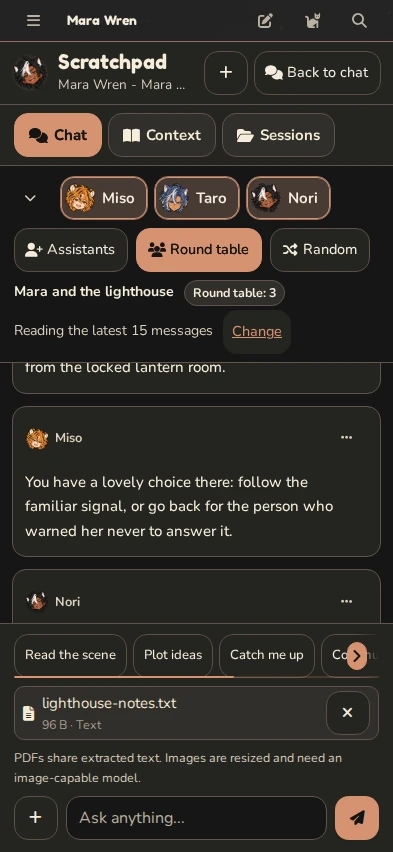

# Scratchpad

Scratchpad is a side conversation for ideas, continuity checks and proposed edits. Talk with Miso, Taro, Nori or an assistant of your own. The discussion doesn't become part of the story.

=== "Computer"

    <figure class="screenshot" markdown>
    
    <figcaption>Discuss the scene without adding the planning to it.</figcaption>
    </figure>

=== "Phone"

    <figure class="screenshot screenshot--phone" markdown>
    
    <figcaption>Back to chat returns to the story.</figcaption>
    </figure>

## Open a discussion

1. Open **Scratchpad** from the workspace or chat tools, or **Ask Scratchpad** from a notebook note.
2. Choose an assistant under **Talking with** and a connection.
3. Check **Show preview** to see what you're sharing, then send your question.

From Home, **General Scratchpad** starts without hidden chat context. Quick prompts such as **Plot ideas** and **Continuity check** fill the message box for you to edit and send. Ordinary discussions don't need special tool-call support from the model.

## Add files and images {#scratchpad-attachments}

Press **+** (Message options) beside the message box and choose **Attach files**. You can attach up to eight files to one message, with or without typed text. Each original file can be up to 32 MiB; after resizing and text extraction, the attachments on one message can total 2 MiB.

Images are resized to at most 2048 pixels on the longest side. Choose PNG, JPEG, WebP, GIF or another image your browser can open; Neconyan converts it to PNG or JPEG before sending. Image attachments need a Chat Completion connection with a model that accepts images. Text files, JSON, CSV and Markdown are read as text up to 1 MiB. PDFs use selectable text, up to 300 pages and 1 MiB of extracted text; a scanned PDF needs its pages attached as images. Other binary files are refused rather than sent as broken text.

Press the **X** beside an attachment to remove it before sending. Attachments stay with their message and are included as earlier conversation later in the session. Draft attachments survive switching sessions while the page stays open, but not a browser reload. Session exports keep message text only, so keep attached files and images separately.

## Add your own assistant

Open **Assistants → Your assistants**. **Add a new assistant** takes a name and personality, with an optional picture and example dialogue. **Use a character card** makes an independent assistant copy; later card edits don't change it.

**Edit → Save assistant** changes future replies. Deleting an assistant removes it from your library, but old sessions keep the copy they used. You can keep up to 24 assistants.

## Check exactly what it will read

**Show preview** lists the current context. Choose recent or selected messages and optional cards, **Your persona and Scenario Notes**, lore or Author's Note. Shared character cards are included as saved, including their greetings, examples and instructions.

In Roleplay, **Also share → Current preset** adds your preset separately, with prompts marked on or off. It starts off. Sharing it also makes the selected preset an edit target; [Review a proposed change](#review-a-proposed-change) covers that. Conversation doesn't use these presets.

Important boundaries:

- **General** shares no chat, swipes, lore or preset. You can explicitly share a selected card, persona and permitted notes.
- Picked messages stay tied to their original chat. Switching chats doesn't substitute different messages.
- Scratchpad doesn't automatically read Mewmory or Companion notes.
- A linked note isn't automatically shared. Notebook permissions still apply.
- **Ask Scratchpad** from a note shares that note or selection for 30 minutes after confirmation. It doesn't add the story beside it. Tick **Allow proposed edits to the shared text** for suggestions, or use **Stop sharing** to end access.

Context and note permissions are checked again when you send. Removing permission can't withdraw text already sent to a provider.

## Search the web

Choose a provider under **Context → Web search**. Brave, Exa and Tavily need their own keys; NanoGPT uses your saved key. SearXNG needs an instance with JSON output enabled. Custom search addresses must return supported JSON results.

Open **+** (Message options) beside the message box and turn on **Web search** for the next message. Only that message, trimmed to 400 characters, goes to the search service. Your cards, notes and earlier conversation stay out of the search query.

One search serves the whole round table. Replies cite numbered results and keep a folded **Sources** list. If search fails, the assistants can still answer, with a notice. **Stop** cancels an active search too.

## Ask more than one assistant

Turn on **Round table** and select up to three assistants. Each answers with its own connection and reply limit, without seeing the others' answers from that round. Ask a follow-up to compare their ideas.

**Random** asks just one selected assistant per message. Turn it off to ask everyone again. Each answer can be a separate paid request; **Stop all** stops the round and failed participants can be retried individually.

## Review a proposed change

An assistant can propose changes to supported cards, lorebooks, Roleplay messages, the shared preset and notebook notes. With **Your persona and Scenario Notes** shared, it can also change the persona's name, description or title, or an existing note's name or text. Persona edits change the saved base fields in every chat; note edits affect every chat using that note and keep its activation. It can also draft a brand-new persona or note; [Create a persona or Scenario Note](#create-a-persona-or-scenario-note) covers that. Open **Review**, compare **Now** with **Proposed text**, then choose **Save change**. A proposal appearing is not a save.

With **Current preset** shared in Roleplay, the assistant can replace one field in the selected preset. For Chat Completion, that can be one prompt module's text, name, role, on/off state, in-chat position or depth; a slot filled from the card, chat or persona can only be switched on or off. For Text Completion, it can be one field from the saved system prompt, context template or instruct template. Review the change as usual. **Save change** writes the selected preset, including its current settings, so other chats using that preset get the change too. Sampler, connection and other preset settings aren't available to the proposal, and each proposal changes one field. If the original preset is no longer selected or shared, the review refuses to save.

You can adjust supported non-notebook proposals before saving. Notebook changes save the exact reviewed proposal, so ask for a revision if needed. If the original changed meanwhile, reopen or regenerate the proposal rather than overwriting newer work.

Message and preset edits apply to Roleplay, not Conversation. Return to the original chat to review them. **Use as draft in the chat box** fills the composer without sending.

## Create a character

Ask for a character and review the **New character card** proposal. Adjust its structured draft if needed, then **Save change**. Wait for **Saved** before looking in Characters.

A generated avatar is optional and needs Quick Image Gen configured. For a dedicated workspace with field-by-field revisions, use [Catelier](catelier.md).

## Create a persona or Scenario Note

Ask an assistant for a new persona and it drafts a name, description and title, even when you haven't shared a chat or a persona. Review the **New persona** proposal and press **Save change**; nothing is saved before that press. Wait for **Saved**, then open **Persona**: the new persona is there with the default portrait, and the persona you're using stays selected.

To draft a new Scenario Note instead, share **Your persona and Scenario Notes** and ask for a note on the shared persona. **Save change** saves the note without switching it on in any chat; it waits under **Persona → Scenario Notes** for that persona until you choose where it applies.

The review shows the draft as JSON you can adjust before saving: the name and description, with the title for a persona or the note's own label and text. Macros in a draft stay exactly as written. Saving the same suggestion again doesn't create a duplicate, so retrying a save that failed won't leave two copies behind.

## Images and portraits

**Image idea** drafts a request. **Generate image** starts the image request using Quick Image Gen settings; if prompt review is enabled, approve **Generate reviewed image** first.

Generating a picture doesn't replace a portrait. **Review avatar** compares the pictures and **Save change** applies the replacement to the exact shared card. **Previous avatar** opens the preserved original PNG; it isn't one-click undo.

With **Your persona and Scenario Notes** shared, the assistant can also propose a persona avatar or one saved Scenario Note's avatar. The review shows **Current avatar** and **Proposed avatar**; **Save change** makes the picture live. A persona avatar replaces the portrait across chats and keeps the persona's saved details. A Scenario Note avatar applies while that note is active; ask the assistant to remove its portrait to return to the normal persona picture. The note's text and activation stay as they were.

Image work can continue on the server after you close Scratchpad. **Stop image** requests cancellation. Use **Retry saved job** for retained work rather than buying another image when only local saving failed. An unknown provider outcome isn't automatically purchased again.

Download pictures separately, and keep the original files you attached. Session exports keep text and image prompts, not pictures, attached files, jobs or approvals.

## Edit an assistant's instructions

Use **Context → Assistant prompts → View or edit…**, then **Save prompt**. These instructions belong to Scratchpad, not the ordinary character card. **Reset to default**, followed by **Save prompt**, restores the built-in wording.

Permission rules still apply. Editing an assistant prompt doesn't grant access to private notes.

## Give every assistant the same instructions

Open **Context → Global user instructions → Edit user instructions**. Choose all assistants or selected ones, write your preferences and **Save instructions**.

These account-wide instructions follow you across devices and discussions. A reply already running keeps its original instructions. Save an empty value to turn them off. Session exports don't include them.

## Streaming and reply length

**Context → Stream replies** shows text and available thinking as they arrive. Fold **Thinking** if you only want the answer. Turn streaming off to wait for the complete reply.

**Longest reply (tokens)** limits output, including thinking on models that count it there. New sessions start at 32,000; existing sessions keep their value. Output and thought counts show what the provider reports.

If **Scratchpad is full** appears, export anything you need, then remove old sessions or long replies. The [full reference](https://github.com/platberlitz/Neconyan/blob/staging/docs/scratchpad.md) lists storage limits.

## Sessions and saved results

Open **Sessions** to find, start, export or import a discussion. Roleplay sessions follow the character across chats; groups have their own list. Conversation keeps separate lists for each persona. Note discussions belong to the note, and General has its own account list.

Server-backed replies can continue after closing the page while the server stays available. Switching chats doesn't redirect an edit proposal to another chat.

**Delete old sessions automatically** starts off. Enabling it asks you to confirm the number to keep across all lists. Deletions are permanent; the open session and active replies are protected. Export first if you may want the discussion again.

You can copy a message, selection or session to a notebook. This saves discussion text, leaving out reasoning and change cards, and grants no ongoing notebook access.

Each fenced Markdown block in an assistant reply has its own **Copy** button at the top right, with the tooltip **Copy Markdown**. It copies only that block's contents, without the surrounding fences or the rest of the reply. The **Copy** action on the message still copies the whole message.
