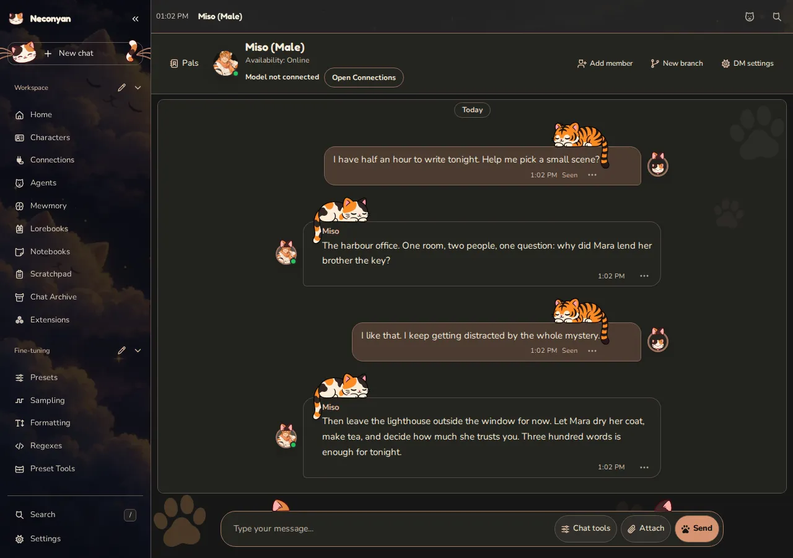
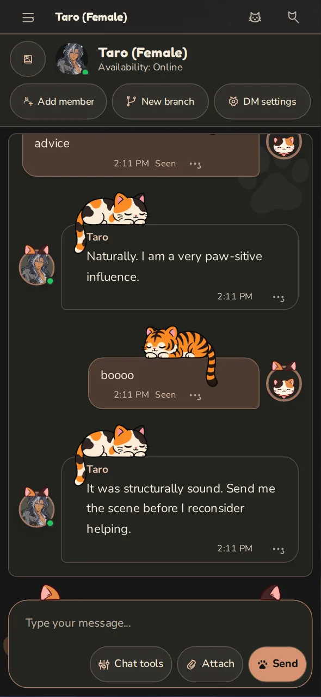

# Conversation

Conversation gives your characters a direct-message and group-chat space. It has separate histories, branches and memory from Roleplay, with messaging features such as replies, reactions, pins, schedules and games.

=== "Computer"

    <figure class="screenshot" markdown>
    
    <figcaption>A staged direct-message conversation, separate from the Roleplay transcript.</figcaption>
    </figure>

=== "Phone"

    <figure class="screenshot screenshot--phone" markdown>
    
    <figcaption>Conversation's messaging layout on a phone.</figcaption>
    </figure>

## Open or create a conversation

Switch an open character to **Conversation**, or open the mode through workspace navigation. **Pals** lists your conversations and offers **Solo chat** and **Group chat**.

Check your persona before starting. Histories and memories are associated with personas, so switching persona can make a familiar conversation appear different or absent without deleting it.

For a group, choose the members you want. Use **Add member** later to expand the conversation. An **@Name** mention can prioritise who should respond.

## How messages are laid out

Conversation looks like a messaging app. Messages from the same sender within 10 minutes form one run: the name appears once at the top and the round avatar once at the bottom. Avatars are cropped towards the top of the picture, so portrait cards usually show the face. A small chip such as **Today**, **Yesterday**, a weekday or a date marks the start of each day.

If your active persona has a Scenario Note with its own avatar, your new messages use that picture. A note without an avatar keeps the normal persona portrait.

Each bubble has a tail. The time, read receipt, token counts and message menu sit in one row along its bottom edge. The header label shows the branch name when you are on a branch. On a phone, **Pals** is an icon button beside the avatar, and character portraits are requested at phone size.

To keep long threads responsive, Conversation renders the most recent 200 messages at a time, or 25 when [Low-memory mode](appearance.md#low-memory-mode) is active. Use **Older messages** at the top of the thread, and **Newer messages** or **Latest messages** at the bottom, to page through history without losing your reading position.

The Windows 98 and Windows XP shell styles, and Termeownal, keep their own Conversation look.

## Watch replies arrive

Open **DM settings**, then **Timing**. In a group, the same button opens **Group controls**. Under **Proactive Messaging**, tick **Streaming** to show reply text as it arrives. It starts off and is saved separately for each direct message and group.

Output and thought token counts appear beside the speaker's name either way, labelled **Output tokens** and **Thought tokens**. They update while the reply is written and stay on saved replies. When one reply is split into several bubbles, its thinking and thought count appear on the first bubble only. Thought counts depend on the provider reporting the model's thinking.

If you reload or reopen the page while a reply is being written, Conversation reconnects to it instead of asking the model again.

## Message tools

The message menu offers actions such as Reply, Copy, Pin, Edit, Regenerate, Branch and Delete where applicable. A reply quotes or targets a message; a pin makes it easier to find again.

The tools area can filter the conversation into **Main**, **Pins**, **Selfies**, **Files**, **OOC** and **Memories**. OOC means out-of-character discussion. Files and pictures have their own views so they don't disappear into a long thread.

## Play a game with the chat {#games}

Open **Chat tools** and choose **Games** in the quick actions row, or send `/games`. Add a game name (`/games chess`, `/games connect-four`, `/games picross` or `/games minesweeper`) to open its setup directly.

The panel opens beside the chat on desktop and fills the screen on a phone. One game is saved per Conversation branch. Switching branches loads that branch's game; closing the panel or reloading the page doesn't lose the saved game, so open **Games** again to resume. **All games** returns to the picker without ending the current game, **End game** discards it, and **New game** or **Play again** replaces it with a fresh one.

Chess and Connect Four are played against the characters in the chat. Choose **How hard** (used when the board has to play a move itself) and who moves first, then press **Start**. Each character turn can make one model request through the chat's connection profile, or through the main API when the chat has none. If the model's answer is missing or not a legal move, the board plays its own move instead. Picross and Minesweeper are solo puzzles with size choices and make no model request. **Hint** suggests a move or square for Chess, Picross and Minesweeper.

Starting and finishing a game adds a short OOC note to the branch. Later replies are told about the game, the board, whose turn it is and the result; for a solo puzzle, characters are told it is yours and not to solve it for you. Game moves stay on the board and are not posted as chat messages.

## New chat, branch or delete?

**New branch** begins another branch while keeping the previous one. **Branch from here** copies the conversation up to the selected point so you can try another direction. A branch may also carry a memory summary; it isn't necessarily an empty mental reset.

Deleting history is a different operation. Read the confirmation rather than using Delete as a shortcut for starting fresh.

## Availability and schedules

Characters can have statuses, schedules and settings that affect when they respond. A delayed reply isn't always a failed model request. Check the conversation's settings and any availability information; **Force** can bypass the normal availability decision when offered.

Scheduled actions still depend on the Neconyan server running. Closing a page is different from shutting down the host or letting Android stop the app.

## Device notifications {#notifications}

Open **Settings → System & Device → Notifications** and turn on **Push notifications**. It's off by default and belongs to this device and account, so enable it on each device you want to hear from. Permission is requested when you turn it on, not while Neconyan starts.

When it's on, Neconyan sends visible toasts and new Conversation DMs as device notifications. Conversation DMs still follow **Mute this DM**, **Priority** and quiet hours. Other toasts appear only when Neconyan would show them on the page. Message previews can appear on the lock screen, so turn the setting off on a shared device if that matters.

Browser notifications need HTTPS or localhost, browser push support and a service worker, plus the Neconyan server running to produce background DMs. On iPhone and iPad, add Neconyan to the Home Screen and enable notifications from that app. The Android and iPhone apps use native notifications and also need their local server running. If the browser or device blocks notifications, the switch stays off and shows the reason; allow them in the browser or device settings, then turn the switch on again. A blocked notifications module doesn't stop the rest of Neconyan from starting.

A device notification opens or focuses Neconyan; it doesn't jump straight to the Conversation thread. Turning the setting off removes this device's subscription, and logging out turns it off. The [phone guide](../start/phone.md#notifications) and [Android guide](../start/android.md#notifications) cover the platform prompts.

## Review image input

While a Conversation chat is open, **Settings → Appearance → Avatar & Chat Styles → Review chat images** opens **Conversation images**. It offers **Don't send chat images to the model** and **Don't send this branch's images to the model**, then a row for each picture in the branch.

Each picture can be **Send the image**, **Use a description** or **Show only**, applied with **Save choice**. A typed description can be up to 16 KiB. The account and branch switches override the individual choices in their scope.

Older messages can combine a picture's description with extracted file text in one saved field. When those parts can't be told apart reliably, the message needs **Use this text** or **Leave it out** before Show only will apply. Omitting also omits the extracted file text in that field. A reply quoting a message with an image can need the same choice; **Leave it out** sends that reply without the quote. Ordinary text-only quotations never require image review. The displayed message, your written text and saved memories stay as they are.

The copy preparation, batch and **Change history** controls belong to the Roleplay review; Conversation pictures are reviewed message by message. [Included tools](../helpers/tools.md#images-in-replies) covers the shared image-input choices.

## Pictures and memory

Conversation pictures use your saved **Quick Image Gen** configuration. A working text connection doesn't configure image generation. Enable the relevant Conversation image setting, set up the image provider and check any image cooldown if a selfie doesn't appear.

A new Conversation picture defaults to **Send the image**; a new Roleplay picture defaults to **Show only**. The choice is **Generated images in replies** in Quick Image Gen, and its separate default is kept for each mode. See [Included tools](../helpers/tools.md#images-in-replies).

Conversation's summaries and memories are separate from Roleplay's [Mewmory](../helpers/mewmory.md). A fact remembered in one mode isn't proof it was carried into the other.

!!! nori "Nori"
    Starting a new branch because I said something embarrassing is technically allowed. Calling it a research methodology is ambitious.

For the full control reference, see the [Conversation glossary in the app repository](https://github.com/platberlitz/Neconyan/blob/staging/docs/conversation-mode-glossary.md).
