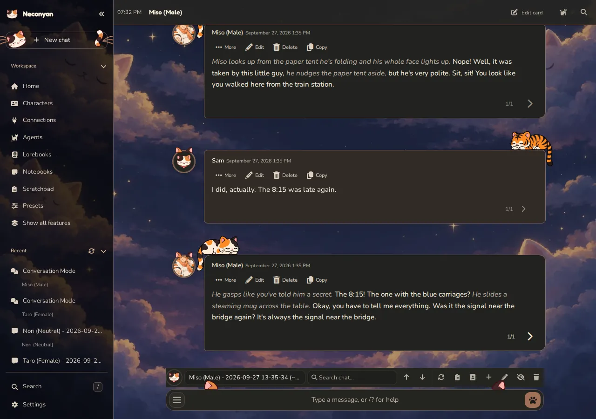

# Find your way around

Home is the starting point for your characters, recent work and connection setup. On a computer, the workspace sidebar stays beside the main area. Use **Collapse sidebar** at its top to turn it into an icon rail; the arrow expands it again. The collapsed rail keeps a clear gap between its groups and centres its icons. On a phone, open the workspace navigation when you need another page, then return to the chat.

## Choose a mode

| Mode | What you work with | Good for |
| --- | --- | --- |
| [Roleplay](roleplay.md) | A character-chat transcript with message actions and swipes | Scenes, narration and long-form roleplay |
| [Conversation](conversation.md) | Direct messages and group conversations, with their own histories | Casual messages, ongoing friendships and a messaging-app feel |
| [Meower](meower.md) | A private character timeline with posts and reactions | Seeing your cast interact in a social feed |
| [Story Mode](story-mode.md) | A continuous manuscript view of a chat | Reading and writing without ordinary message bubbles |

Conversation keeps its own histories, so switching there opens a separate conversation. Story Mode changes how the current chat is displayed.

## Where things live

**Characters** holds the cast, and **Characters & Lore** holds **Persona**, **Character Expressions**, **Quick Image Gen**, **BotSearcher**, **Pawthfinder**, **World Info Lab**, **Lorebook Distiller** and **Card & Lorebook Time Machine**. **Connections** selects the model service. **Lorebooks** adds relevant world information to requests.

**Notebooks** stores your own writing and files. **Scratchpad** gives you a side discussion with an assistant. **Agents** adds configured helpers around replies, **Mewmory** handles source-backed recall for saved Roleplay histories, and **Chat Archive** searches and organises saved chats.

The **Fine-tuning** area contains model presets, sampling, formatting, regex scripts and prompt tools such as **Preset Tools**, **Chat Completion Tabs**, **Prompt Tags**, **Macro Enhanced**, **Prompting Lab** and **Deep Swipe**. A regex is a text-matching rule used to find or replace patterns. You can leave these controls alone while you learn the main chat.

**Appearance** holds **Background**, **Dialogue Colors**, **Termeownal UI**, **CSS Snippets** and **Regex Agent Themes**, and **Troubleshooting** holds **Server**, **Console Logs**, **Debugger** and **Report an Issue**. **Settings** includes appearance, device behaviour, account controls and import tools. **Extensions → Built-in** opens each bundled tool's settings, and **Extensions → Manage extensions** manages whether extensions are enabled. A switched-off sidebar tool shows **Off** and opens **Manage extensions** to turn it on.

## Keep the sidebar simple

Simple Mode is opt-in. Existing accounts keep their current layout. On a new account, Nori asks **Want to keep things simple?** before the First paws tour. **Yes, keep it simple** turns on Simple Mode and shortens the tour; **No, show me everything** keeps the full sidebar. You can also use **Settings → Appearance → Simple Mode** later.

Simple Mode keeps Home, Characters, Connections, Agents, Lorebooks, Notebooks, Scratchpad, Presets, Search, Settings and the composer. It hides Mewmory, Chat Archive, Extensions, the other Fine-tuning pages, the mode switcher, the reasoning-effort button, the wand and image buttons beside the composer, Guided Generations and the rarer items in **Chat tools**.

The **Characters & Lore**, **Appearance**, **Quick Actions** and **Troubleshooting** sidebar groups are hidden too, including Persona, Character Expressions and Quick Image Gen. The top-bar Extensions, Server and Console Logs tabs, Recent's Chat Archive button, and Mass delete and Auto-name controls also step out of view. Nothing is deleted or turned off. Extensions you installed, active lore and running Agents are not removed or disabled.

Press **Show all features** in the workspace sidebar to restore everything. The same switch in Settings turns Simple Mode on again, and the choice is saved for your account.

<figure class="screenshot" markdown>

<figcaption>Simple Mode keeps the chat and the tools you use most. <strong>Show all features</strong> restores the full sidebar.</figcaption>
</figure>

## Search everything

Use **Search** at the bottom of the workspace sidebar, press **/** while you're not typing, or choose **Find a setting** on Home. Search finds pages, tools, modes and settings alongside saved content in your current account. Small spelling mistakes and missing accents can still match; exact matches rank higher.

Saved results include character definitions, persona descriptions, Roleplay messages and swipes, Conversation messages, notebook notes and lorebook entries. Try a distinctive phrase from the thing you remember. Use **More saved results** to see further matches.

Selecting a result opens its page, item or chat. A chat result opens the chat rather than promising a jump to the matching message. If its original character is missing, use the offered **Find in Chat Archive** action.

Search doesn't make a model request or give an assistant permission to read your notes. It searches saved content, not unsaved drafts or other accounts. Settings results depend on which controls and extensions are currently loaded. If some saved content couldn't be searched, treat that warning as an incomplete result, not proof that the item is missing.

## Tours and everyday navigation

Home offers **Replay First paws tour**. Several full-page tools also have a character-led Tour. Follow the highlighted controls yourself; the tour explains the next action while you keep control of the page.

Look beside a page's heading for **Tour**, with its expandable description below. Dismissing a tour invitation leaves the description and Tour button available. **Settings → Appearance → Page tours** lets you restore invitations or separately hide all tour buttons.

On a phone, a sheet or panel may take the full screen. Use its Back or close control to return to the chat. Opening every panel at once is rarely helpful on a small display.

!!! nori "Nori"
    Start with the scene you want to write. I'll help with the complications when you ask. I have suggestions.

Next: [Roleplay](roleplay.md), or [choose a helper](../helpers/index.md) for a specific writing task.
