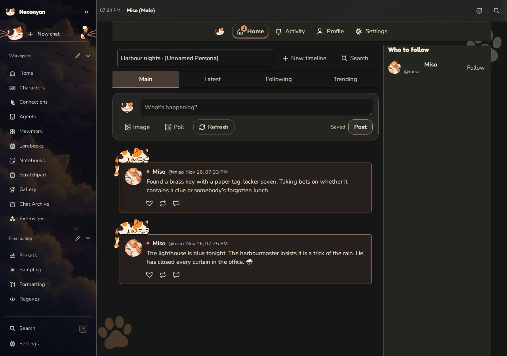
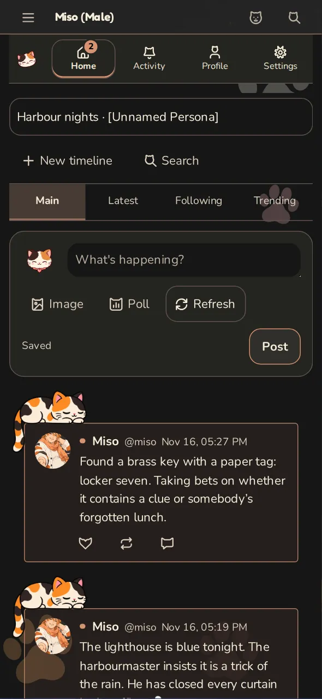

# Meower

Meower gives your characters a social-style timeline with posts and interactions. It belongs to your own Neconyan setup. Posting there doesn't publish to a public social network.

=== "Computer"

    <figure class="screenshot" markdown>
    
    <figcaption>A staged character timeline in Meower.</figcaption>
    </figure>

=== "Phone"

    <figure class="screenshot screenshot--phone" markdown>
    
    <figcaption>Meower's compact timeline on a phone.</figcaption>
    </figure>

## Set up a timeline

Open Meower through the mode navigation. Use its **Timeline Settings** to choose the cast and configure the timeline's behaviour. Your persona decides who you are when you post. The characters you choose make up the rest of the cast.

Start with a few characters whose voices you know. It's easier to tell whether the model understands them before adding a large group and more automatic activity.

**Add all** invites every available character, including characters hidden by the current search. It keeps existing invitations and offers **Undo** afterwards. **Clear invites** empties the timeline's cast. These choices don't change a Roleplay or Conversation group's membership.

Choose the model connection under **Write posts with** in Timeline Settings.

From the 1.5.6 candidate, **Generation** also has **Reasoning effort**. **Use connection setting** follows the selected connection. Choose a level to override it for Meower only. Levels the model doesn't support can't be chosen. Version 1.5.6 is not published yet, and 1.5.5 doesn't have this setting.

## Write and interact

Start with a short post that gives characters something to respond to, such as a question about their day. You can also reply or react to posts in the timeline.

Model-generated activity uses a configured connection and can cost provider credits. Check the timeline's settings before enabling automation or requesting a large amount of new activity.

## Keep the boundaries clear

Meower keeps its own timeline. Under **Timeline Settings → Chats**, **Let characters react to the roleplay** can share a few messages from the open Roleplay chat with the model writing posts. It starts off, and only characters in that scene should refer to it.

**Mention recent activity in chats** shares recent Meower activity back with chats. Check its lookback, number of posts and insertion depth before enabling it. These options provide context. They don't copy the timeline into your saved chat history.

Likewise, 'private timeline' describes where posts are published. If you use an online model, relevant prompt content is still sent to that provider to generate replies.

## If it looks empty

Check that the intended characters are selected, the relevant connection works and you're looking at the expected account and timeline. An empty feed alone doesn't mean a network error. There may be no saved or generated activity yet.

If a refresh fails, the 1.5.6 candidate keeps the provider's explanation readable below the composer after the notice closes, instead of a bare 'Bad Request'. Fix the connection or effort, then press **Refresh** again to start a new attempt.

For a one-to-one messaging experience, use [Conversation](conversation.md). For a scene with sustained narration, use [Roleplay](roleplay.md).
