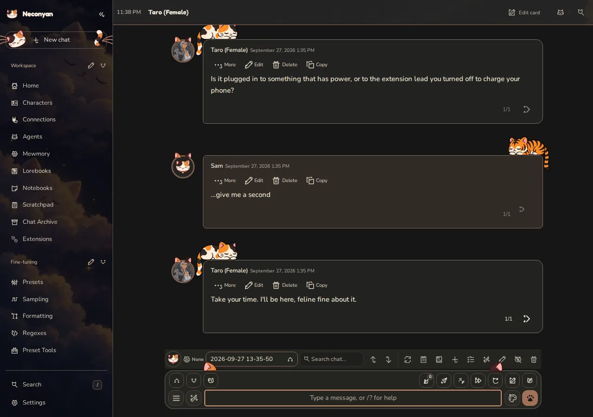

# Roleplay

Open a character and write together, whether you want a casual conversation or a long-running story.

=== "Computer"

    <figure class="screenshot" markdown>
    
    <figcaption>Read the scene, then give the character something to respond to.</figcaption>
    </figure>

=== "Phone"

    <figure class="screenshot screenshot--phone" markdown>
    
    <figcaption>The composer stays beside the conversation.</figcaption>
    </figure>

## Start a scene

1. Open a character and choose **Roleplay**.
2. Open a saved chat or start a new one.
3. Check your persona, then write your first message.

The model can also receive the character card, persona, preset, lore, Author's Note and enabled helpers. If the tone feels wrong, check those instructions before adding more.

## Work with replies

| You want to… | Use… |
| --- | --- |
| Try another answer | **Regenerate** or generate a new swipe |
| Fix a particular sentence | **Edit** |
| Extend the current answer | **Continue**, where available |
| Give a direction for a replacement | Type it, then **Guided Regenerate** |
| Keep the original alongside a guided alternative | **Guided Swipe** |

Choosing a saved swipe doesn't make another model request. Click the swipe counter on a computer, or hold it on a phone, to compare versions. Choose **Show swipe** to use one. Earlier replies can be read, copied or branched into a new chat from this view.

An empty composer makes Guided Regenerate behave like an ordinary regeneration. Stop current work before editing the history it relies on.

If the main reply has finished, **Stop** ends the remaining Agent work and keeps that reply. A [Quick Reply](../helpers/tools.md#quick-replies) can also steer the next answer with a one-use note that isn't added as a chat message.

## Run a group scene

Choose how the group takes turns:

- **Natural order** follows the conversation.
- **List order** follows the member order.
- **Pooled order** randomly picks a member, preferring those who haven't spoken since your last message.
- **Manual** lets you choose a speaker.
- **Scene Director** asks a separate model which members should speak. It can choose nobody and falls back to ordinary selection if it fails.

**Let them talk** runs a short exchange between at least two unmuted members. Choose one to eight turns; the default is three. Stop, send a message, switch chats or leave the page to end it. Ensemble writing produces the scene in one request instead of one request per speaker.

Use **Scene** to set the location and mark who is present. **Whisper** targets present, unmuted members; absent characters don't receive it. A member's **Use as Narrator / GM** option adds a reminder for that speaker. It doesn't give them control over everyone else or unmute them.

??? info "Scene Director requests"

    The director reads the last eight messages and chooses up to three speakers. Its separate request has a three-second limit and can use a saved connection profile.

## Images in replies

Open **Settings → Appearance → Avatar & Chat Styles → Review chat images** to choose what the model receives:

- **Send the image** needs a model that can read images and **Send inline media** enabled.
- **Use a description** sends the written description.
- **Show only** keeps the image visible without sending either.
- **Remove from message** removes the reference without deleting its file.

Press **Save choice** after choosing. Account or chat settings that say **Don't send** take priority. Changing a choice doesn't alter a request the provider has already accepted; stop and retry if needed. For a stuck review notice, see [troubleshooting](../help/troubleshooting.md#image-input-needs-attention).

## Chat and writing settings

Start with **Settings → Chat & Writing**:

- **Chat & messages → Chat window** controls chat links and **Reopen your last chat**. Both start off. Links work on your installation and account; they aren't public copies.
- **Chat & messages → Sending** includes whether the keyboard opens automatically.
- **Replies → Where replies are written** chooses **In the browser** or **On the server**. See [leaving the page](#when-you-leave-the-page) before changing it.

Automatic chat names use a model request after a date-named chat has enough messages and you've sent one. The default is six messages, including the greeting. You can change the threshold or turn naming off. Assistant and temporary chats, and Conversation mode, are excluded.

The message timer stops when the main reply finishes, rather than counting Agent work afterwards. A cut-off reply keeps any received text or thinking; it doesn't start after-reply Agents as though the answer had completed.

If a reply finishes with thinking but no text, the bundled **Thinking Reply Recovery** Agent can write the missing reply from that thinking and pass it to your other after-reply Agents. It starts switched off; turn it on in Agents. A routine chat save while a long reply is being written no longer makes it skip, and the recovered prose is written into the chat.

## When an Agent fails

A failed Agent shouldn't cost you the main answer. Neconyan keeps the completed reply and successful changes from other helpers. A failed helper may retry once, which can cost another request. If no rewrite succeeds, the original reply remains.

Translation or speech failures also leave the answer intact. If you changed or deleted the source chat while work was running, check its saved request before trying again. See [Agents](../helpers/agents.md#troubleshoot-a-helper).

## Replies saved by the previous version

After an update, Neconyan can recover a completed server reply that wasn't attached to its chat. It checks the original chat first and doesn't ask the model to write it again.

If the chat has changed, inspect **Server requests** rather than resending. Cancelled or dismissed work isn't restored automatically. Recovery waits until normal startup if you're in Safe Mode.

## Keep prompt switches beside the chat

On a computer, Chat Completion prompts can be pinned beside the chat. Pinning makes a switch easier to reach; it doesn't enable the prompt. The panel follows the preset's order and disappears when you unpin the last item.

You can manage pins on a phone, but the beside-chat panel is desktop-only. See [model settings](model-settings.md) for the prompt itself.

## Formatting and scripts

Open the formatting settings for message appearance, find-and-replace rules and scripts. Start with one rule and test it on a saved reply.

Interactive message scripts run in a separate widget. If a browser can't block their network access, **Run anyway** permits access that may send data outside the app. Only use it for scripts you trust. Update an older Android app if it asks for a newer script bridge.

### Find-and-replace rules

1. Describe what you want changed.
2. Choose whether the rule belongs to **Global**, **Preset** or **Character**.
3. Choose a connection and select **Draft**.
4. Read the result in the editor and use **Test Mode** before saving.

**Improve** revises an existing rule. **Show last reply** includes up to 1,500 characters as an example. Each draft or improvement is a model request; a failed request keeps your current rule.

### Regex flags {#regex-flags}

A regular expression is a pattern for finding text. Its flags change what it matches:

| Flag | Meaning |
| --- | --- |
| `g` | Replace every match |
| `i` | Ignore upper and lower case |
| `s` | Let `.` match line breaks |
| `m` | Treat each line as a beginning and end |

Without flags, a normal match is case-sensitive and stops at the first result. The **Options** chips update the pattern for you. Try the recipes in **Test Mode** before using them on a chat.

### Script parser options {#script-parser-options}

**Strict escaping** and **literal variables** start off. A script can set its own behaviour with `/parser-flag` instead of changing the account default. See the [macro and scripting reference](../macros/index.md) for syntax.

For scripts that start replies, `/is-generating` checks whether work is active; `/wait-generation` waits for it. Its default timeout is 60,000 milliseconds, while `0` waits without a limit. `/stop` and `/generate-stop` stop generation. `/getinput` reads the composer; `/trigger`, `/gen` and `/genraw` start writing.

If a composer script fails, its text is restored only while the composer is still empty, so newer typing isn't overwritten.

## Keep the model informed

Put stable character details in the card, world facts in [lorebooks](lorebooks.md), and the current scene direction in Author's Note. [Mewmory](../helpers/mewmory.md) recalls older events. [Scratchpad](../helpers/scratchpad.md) helps plan changes before applying them.

### Author's Note {#authors-note}

Author's Note adds a short instruction to the prompt. Its tabs choose where that instruction belongs:

- **This chat:** the current chat's note. Frequency `1` sends it every turn; `0` stops regular insertion. Lore scanning is a separate setting.
- **Character:** private notes for this character. Tick the ones to use and choose Top, Replace or Bottom. These can be separate for each persona.
- **Persona:** one active private profile that follows the persona across characters.
- **New chats:** defaults for chats you create later.

Top notes come before the chat note, character first and persona second. Bottom notes follow it in the same order. Conversation mode has its own Author's Note settings.

## Manage saved chats {#saved-chats}

Use **Switch chat** to search and reopen a conversation. For file actions, choose **View chat files** on desktop or **Manage files** in the phone's chat tools.

From there you can start or import a chat, export it, rename it, or delete it. JSONL keeps the chat structure; plain text and Readable Replies are for reading elsewhere. Importing as a new instance keeps it separate from the original.

**Label** can name the current chat or date-named chats with a model request. For cleanup, choose **Older than** and **Keep newest**, then **Preview** before **Clean**. Cleanup targets date-named chats by default and protects the open chat and newest one. [Back up first](../help/backups.md).

## When you leave the page

**In the browser** is the default for ordinary Roleplay. Most single-character replies can be held by the server if the page disconnects, then recovered when you return. After-reply Agents aren't replayed automatically; use **Rerun agents** if needed.

If you return while a reply is still being written, it appears after the last saved message rather than above the greeting. A replacement reply keeps its existing place.

Choose **On the server** when you want supported writing and Agents to continue after closing the page. The server must stay running. Conversation, Notebook writing and supported one-to-one guided replies already use server work; some group or page-only features still need the browser.

Instructions that require the browser may prevent a server request or send supported work back to the browser. Notebook writing reports unsupported instructions rather than silently dropping them.

If you reconnect during a reply, let Neconyan check the saved request before sending again. Inspect **Server requests** if the result doesn't appear.

??? info "How long browser replies are held"

    The temporary hold is normally 15 minutes, or up to 24 hours with chat context. Restarting the server loses that temporary hold. Explicit server requests use saved jobs instead.
